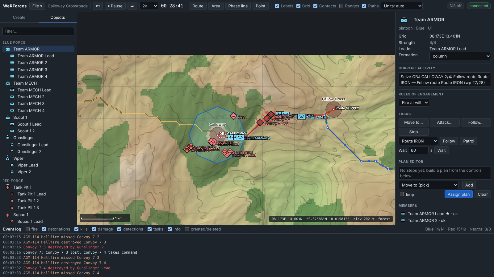

# WeRForces

WeRForces is an open computer-generated forces (CGF) simulator, modelled on the
architecture and workflow of MAK's **VR-Forces**. It has a simulation back-end, a
browser-based scenario editor with **2D and 3D views**, entity and unit models with
tasks and plans, sensors, direct and guided fire with damage adjudication, and
**DIS (IEEE 1278.1)** networking, so other DIS simulations can see and engage its
entities. It covers artillery with forward observers, mounted infantry,
reactions, fog of war with per-side player access, recording with after-action
review, and real-world terrain imported from elevation data and OpenStreetMap.

It also connects to other systems:

- a versioned **REST API** with an OpenAPI spec;
- an **MCP server**, so AI agents such as Claude can inspect and command the
  simulation;
- **TAK / Cursor-on-Target** output for ATAK, WinTAK and TAK Server;
- **webhooks** for Slack, Discord or any HTTP endpoint;
- **GeoJSON and KML** feeds for QGIS and Google Earth.

> VR-Forces is a product of MAK Technologies. WeRForces is an independent
> project, not affiliated with or derived from MAK's software. It reimplements
> the general CGF concepts from public descriptions.




## Documentation

The full documentation is in [`docs/`](docs/README.md). A running server also
serves it at **`/docs`** (toolbar → **Help**).

- [Getting started](docs/getting-started.md)
- **Tutorials:**
  [1 First engagement](docs/tutorials/01-first-engagement.md) ·
  [2 Routes, plans and conditions](docs/tutorials/02-routes-plans-and-conditions.md) ·
  [3 Building a scenario](docs/tutorials/03-building-a-scenario.md) ·
  [4 REST API scripting](docs/tutorials/04-scripting-with-the-rest-api.md) ·
  [5 AI agents with MCP](docs/tutorials/05-ai-agents-with-mcp.md) ·
  [6 DIS](docs/tutorials/06-dis-interoperability.md) ·
  [7 TAK, webhooks, GIS](docs/tutorials/07-tak-webhooks-and-gis.md) ·
  [8 Monte Carlo analysis](docs/tutorials/08-batch-and-monte-carlo.md) ·
  [9 Extending the catalog](docs/tutorials/09-extending-the-catalog.md) ·
  [10 Fire support and mech infantry](docs/tutorials/10-fire-support-and-mech-infantry.md) ·
  [11 Exercise control and AAR](docs/tutorials/11-exercise-control-and-aar.md) ·
  [12 Real terrain](docs/tutorials/12-real-terrain.md)
- [User guide](docs/user-guide.md) · [Concepts](docs/concepts.md) · [Terrain import](docs/terrain-import.md) · [Deployment](docs/deployment.md) · [Architecture](docs/architecture.md) · [FAQ](docs/faq.md)
- **Reference:**
  [CLI](docs/reference/cli.md) · [REST API](docs/reference/rest-api.md) ·
  [MCP tools](docs/reference/mcp-tools.md) · [Catalog](docs/reference/catalog.md) ·
  [Scenario format](docs/reference/scenario-format.md) · [DIS](docs/reference/dis.md) ·
  [Integrations](docs/reference/integrations.md)
- Runnable [examples](examples/) in Node.js, Python and TypeScript

## Quick start

```bash
npm install
npm run build
npm start -- --scenario calloway-crossroads      # http://127.0.0.1:8080
```

Open the URL, press **Space** (or ▶ Run), and set the time multiplier to 8–16×.

With Docker (`docker compose up -d` adds HTTPS; see [Deployment](docs/deployment.md)):

```bash
docker build -t werforces . && docker run -p 8080:8080 -e WERFORCES_API_KEY=change-me werforces
```

Useful options (`npm start -- --help` lists all of them):

| Option | Meaning |
| --- | --- |
| `-s, --scenario <file\|name>` | Load a scenario JSON file, or a name from `./scenarios` |
| `-p, --port`, `--host` | HTTP/WebSocket port (8080) and interface (127.0.0.1) |
| `--run`, `--time-scale <x>` | Start running immediately, at a time multiplier |
| `--dis` | Enable DIS over UDP |
| `--dis-port`, `--dis-address` | UDP port (3000) and destination: broadcast, multicast group or unicast host |
| `--exercise`, `--site`, `--application` | DIS exercise and simulation address |
| `--api-key <key>` | Require a key on `/api`, `/ws` and `/mcp` (or set `WERFORCES_API_KEY`). The exercise-control key |
| `--player <force:key>` | A player key: that force only, with fog of war. Repeatable |
| `--record-interval <s>` | Recording rate for the after-action review (1 s; 0 = off) |
| `--terrains <dir>` | Imported terrain datasets (`./terrains`) |
| `--cors <origin>` | Allow cross-origin browser access from an origin (`*` for any). Repeatable |
| `--cot <url>`, `--cot-interval <s>` | Stream Cursor-on-Target to `udp://239.2.3.1:6969` (ATAK multicast) or `tcp://host:8087` (TAK Server) |
| `--webhook <url>` | POST simulation events to a URL. Slack and Discord webhook URLs get chat formatting. Repeatable |
| `--catalog <file>` | Add or replace entity types, weapons, sensors and unit templates from a JSON file ([Tutorial 9](docs/tutorials/09-extending-the-catalog.md)) |
| `--headless [--duration <s>]` | No GUI. With `--duration`, runs as fast as possible and prints the event log and losses |

## VR-Forces concepts mapped to WeRForces

| VR-Forces concept | WeRForces |
| --- | --- |
| Simulation engine (back-end) | `src/sim/engine.ts`: fixed-step (0.1 s) deterministic engine with seeded RNG |
| Front-end GUI / scenario editor | `web/`: 2D tactical map, 3D scene view (Three.js), palette, object tree, inspector, plan editor, event log |
| Simulation Object Model (entity, weapon and sensor parameters) | `src/sim/catalog.ts`: 27 entity types, 26 weapons, 9 sensors, 16 unit templates |
| Terrain database | `src/sim/terrain.ts`: procedural terrain, or real terrain imported from GeoTIFF elevation and GeoJSON/OSM features (`src/terrain/`); LOS, mobility and route planning |
| Tasks | Move to, Follow route, Patrol, Wait, Follow entity, Attack, Orbit, Fire mission, Mount, Dismount, plus internal formation keeping |
| Plans | Ordered statements: tasks, set ROE/speed/altitude/formation/reactions, *wait until* (time, in area, enemy in area, enemy detected, under fire, strength below, entity destroyed), optional loop |
| Reactive behaviour / ROE | Fire at will, Return fire, Hold fire; halt on contact, withdraw below a strength, call for fire. Automatic target and weapon selection |
| Indirect fire | Howitzers and mortars: fire missions with sheaf, dispersion and blast effects; automatic call for fire by observers, with danger-close checks |
| Embarked entities | Infantry riding in IFVs, trucks and helicopters; mount, dismount, losses with the carrier |
| Exercise roles | Exercise-control and per-force player keys with server-side fog of war (GUI, REST and MCP) |
| After-action review | Continuous recording, replay on the 2D/3D map, bookmarks, AAR report, saved recordings |
| Units / aggregates | Leader + followers in column, line, wedge, vee and echelon formations. Unit tasking, contact sharing and leader succession. Aggregated symbols when zoomed out |
| Tactical graphics | Routes, areas, phase lines, points |
| Sensors / perception | Range, field of view, terrain and forest-canopy line of sight, probabilistic detection. Per-entity contact lists shared within a unit |
| Weapons & damage | Munition fly-out, range/motion/concealment-modified Pk, mobility, firepower and catastrophic kills |
| Remote Control API | REST API `/api/v1` with OpenAPI (`src/server/apiV1.ts`), WebSocket commands, MCP server (`src/mcp/`) |
| Network interoperability (VR-Link) | DIS gateway (`src/dis/`): Entity State, Fire and Detonation PDUs, dead reckoning, heartbeats, remote entity reflection |
| Rewind / save / load / checkpoint | Rewind to scenario start; save to the server or download; import a file. Saving mid-run is a full checkpoint that continues identically |
| Batch / headless runs | `--headless --duration <s>`, the engine as a library, `npm run bench` (1000 entities at ~20× real time) |
| Interoperability with C2 / GIS tools | Cursor-on-Target to TAK, webhooks, GeoJSON/KML (`src/integrations/`) |

## Using the GUI

- **Create**: choose a force, pick an entity or unit template, and click the map to
  place it. Shift+click keeps placing. Esc cancels.
- **Select**: left-click a symbol, or use the **Objects** tree. Double-click a tree
  item to centre on it.
- **Task**: right-click the map with something selected to get *Move here*,
  *Attack*, *Follow*, *Follow/Patrol route* (right-click a route) and *Orbit
  here* (aircraft). The inspector has the same tasks as buttons.
- **Plan**: build a plan in the inspector's plan editor and press *Assign plan*.
  The plan's current step shows under *Current activity*.
- **Draw** routes, areas, phase lines and points from the toolbar. Click to add
  points; double-click, Enter or right-click finishes.
- **Alt+drag** repositions an entity. The mouse wheel zooms; dragging pans.
- **2D / 3D / Split** (toolbar) switches between the tactical map and a 3D scene:
  shaded terrain with roads and towns, vehicle/aircraft/ship models in force
  colours, draped routes and objective areas, tracers and detonations. In 3D,
  drag orbits, right-drag pans, the wheel zooms, a click selects, double-click
  focuses, and right-click opens the same tasking menu as 2D. *Follow selected*
  keeps the camera on the selection. *Vertical ×N* sets terrain exaggeration.
  Three.js only loads the first time you open 3D.
- **Integrations** (toolbar) shows API and MCP connection snippets, configures
  TAK output and webhooks, and links the GeoJSON/KML feeds.
- **Layers** menu: labels, grid, sensor contacts (yellow lines; red = engaging),
  weapon and sensor range rings, planned paths, and unit aggregation.
- Keys: **Space** run/pause, **F** centre on the selection, **Delete** remove it.

## Architecture

```
   browser (web/)            AI agents (MCP)      scripts / C2 / GIS       other DIS sims
 2D map · 3D view · editor    Claude, ...          curl, QGIS, Earth       (VR-Forces, VBS)
        │ /ws                    │ /mcp or stdio      │ /api/v1                 ▲ UDP 3000
 ┌──────▼────────────────────────▼────────────────────▼───────────┐   ┌─────┴──────────┐
 │ SimServer (src/server): auth · REST v1 + OpenAPI · MCP · WS    │   │ DisGateway     │
 │ commands.ts: validated remote control                          │   │ src/dis        │
 ├────────────────────────────────────────────────────────────────┤   └─────▲──────────┘
 │ IntegrationHub (src/integrations): CoT → TAK · webhooks · GIS  │─► TAK / Slack / ...
 └──────┬─────────────────────────────────────────────────────────┘         │ hooks
        │ SimRunner: real time, pause, time scale                            │
 ┌──────▼────────────────────────────────────────────────────────────────────┴──┐
 │ Engine (src/sim/engine.ts)                                                    │
 │  units → plans → tasks → movement → sensors → combat → impacts               │
 │  terrain · catalog · entities · units · graphics · event log                 │
 └───────────────────────────────────────────────────────────────────────────────┘
```

Each 0.1 s step runs, in order: unit leader succession, withdraw reactions, unit
and entity plans, tasks (which produce steering commands; halt-on-contact holds
position), kinematics (passengers ride with carriers), sensor scans (1 Hz,
staggered, using a spatial grid), call for fire, weapon selection and firing,
munition impacts (area damage for indirect fire), then recording.

### Models

- **Movement.** Ground vehicles turn and accelerate within their type's limits.
  Speed depends on road vs. off-road, forest and slope; water and steep slopes are
  impassable. Dismounts are slower but less affected by forest. Boats stay on
  water. Aircraft follow the terrain at a commanded height above ground, using
  look-ahead and climb-rate limits, and fixed-wing aircraft cannot drop below
  minimum speed.
- **Route planning.** Ground and sea routes come from A* over the terrain grid,
  minimising travel time, so vehicles use roads where they can. Routes are
  smoothed by string pulling and replanned when a vehicle gets blocked.
- **Sensors.** Each sensor has a range, a field of view and the domains it can
  detect. Ground observers' line of sight is blocked by terrain and by a 15 m
  forest canopy. Detection probability falls with range. Forest and dismounted
  targets are harder to see; moving or recently-firing targets are easier.
- **Combat.** Pk depends on the weapon against the target's armour class, then on
  range, shooter motion (unguided rounds), target speed and concealment. Rounds
  take flight time to arrive. A hit rolls for a catastrophic kill, otherwise a
  mobility or firepower kill; losing both counts as destroyed. Damage to remote
  (DIS) entities is left to the simulation that owns them.
  Wire-guided missiles miss if their launcher dies or loses sight of the target.
- **Indirect fire.** Rounds land with range-dependent dispersion and damage
  everything within the blast radius, falling off with distance.

## DIS interoperability

- PDUs: **Entity State** (1), **Fire** (2), **Detonation** (3). Protocol version 7
  is sent; versions 4–7 are accepted.
- Coordinates: the local flat frame maps to WGS-84 geodetic coordinates and then
  to geocentric (ECEF) positions. Orientation uses DIS ψ/θ/φ Euler angles relative
  to ECEF, and velocity is sent in ECEF.
- Publishing: an Entity State PDU goes out when the dead-reckoned position
  drifts by more than 1 m, orientation changes by more than 3°, appearance
  (damage, smoke, flames) changes, or the 5 s heartbeat expires. Paused
  simulations send zero velocity. Deleted entities are sent once with the
  *deactivated* appearance bit.
- Receiving: remote entities are matched to the closest catalog type by DIS
  enumeration, dead-reckoned (FPW/FVW/RVW) and timed out after 12 s. They can be
  detected and engaged. Detonations aimed at local entities are adjudicated
  locally.
- Try it with two instances on one machine:

  ```bash
  npm start -- -s calloway-crossroads --dis --dis-address 127.255.255.255
  npm start -- -s lakeside-patrol --dis --dis-address 127.255.255.255 --site 2 --port 8081 --run
  ```

  Each instance shows the other's entities with dashed, yellow-outlined symbols.

DIS entity enumerations in the catalog follow the SISO-REF-010 layout but are
representative. Check them against current SISO enumerations before you join
a real federation.

## REST API (`/api/v1`)

The full reference is at **`/api/docs`** and the machine-readable spec at
`/api/v1/openapi.json`. Positions can be given as `{x,y}` (local metres),
`{lat,lon}` or `{town:"Calloway"}`.

```bash
H='Content-Type: application/json'
curl -s localhost:8080/api/v1/simulation                     # status, strength, towns
curl -s -H "$H" localhost:8080/api/v1/units -d '{"templateId":"us-tank-platoon","force":1,"position":{"town":"Eastwick"}}'
curl -s -H "$H" localhost:8080/api/v1/units/U1/task -d '{"type":"moveTo","target":{"town":"Calloway"}}'
curl -s -H "$H" localhost:8080/api/v1/simulation/step -d '{"seconds":300}'   # simulate 5 min now
curl -s 'localhost:8080/api/v1/events?kinds=destroyed,damaged'
```

| Resource | Endpoints |
| --- | --- |
| Simulation | `GET /simulation`; `POST /simulation/run`, `pause`, `rewind`, `step`; `PUT /simulation/time-scale` |
| Scenario | `GET`/`PUT /scenario`; `POST /scenario/new`; `GET /scenarios`; `GET`/`PUT /scenarios/{name}`; `POST /scenarios/{name}/load` |
| Catalog | `GET /catalog`, `/catalog/entity-types`, `/catalog/unit-templates` |
| Entities | `GET`/`POST /entities`; `GET`/`PATCH`/`DELETE /entities/{id}`; `POST /entities/{id}/task`, `plan`, `stop`; `GET /entities/{id}/path` |
| Units | `GET`/`POST /units` (from a template, or group entities); `GET`/`PATCH`/`DELETE /units/{id}`; `POST /units/{id}/task`, `plan`, `stop` |
| Graphics | `GET`/`POST /graphics`; `GET`/`PATCH`/`DELETE /graphics/{id}` |
| Events | `GET /events?since=&kinds=&limit=` |
| Terrain | `GET /terrain`; `GET /terrain/point?x=&y=` (or `lat`/`lon`/`town`); `POST /terrain/line-of-sight`; `POST /terrain/route` |
| Integrations | `GET /integrations`; `GET`/`PUT /integrations/cot`; `GET`/`POST /webhooks`; `DELETE /webhooks/{id}`; `POST /webhooks/{id}/test` |
| Export | `GET /export/entities.geojson`, `/export/graphics.geojson`, `/export/scene.kml`, `/export/live.kml` |

The GUI also uses `POST /api/command` and the `/ws` WebSocket. Both take the
command objects in `src/shared/types.ts`.

### Security

- The server listens on 127.0.0.1 by default. It rejects requests whose `Host`
  header is not a loopback name, which blocks DNS rebinding.
- `POST` and `PUT` must send `Content-Type: application/json`, so other
  websites can't drive the API with form posts.
- WebSocket connections from other browser origins are refused unless allowed
  with `--cors`.
- `--api-key` (or `WERFORCES_API_KEY`) protects `/api`, `/ws` and `/mcp`. Send
  the key as `Authorization: Bearer <key>`, `X-API-Key`, or `?api_key=` for
  links. The GUI asks for the key once and remembers it.
- Use `--host 0.0.0.0` only together with `--api-key`, on a network you trust.

## MCP server (AI agents)

WeRForces is an [MCP](https://modelcontextprotocol.io) server, so an AI agent can
read the situation, create forces, issue tasks and plans, run the clock, and
report what happened.

- **Streamable HTTP**, built into the server at `/mcp`:

  ```bash
  claude mcp add --transport http werforces http://127.0.0.1:8080/mcp
  # with a key: ... --header "Authorization: Bearer <key>"
  ```

- **stdio bridge** for clients that launch a process (e.g. Claude Desktop):

  ```json
  { "mcpServers": { "werforces": { "command": "node",
      "args": ["/path/to/WeRForces/dist/mcp/stdio.js", "--url", "http://127.0.0.1:8080"] } } }
  ```

Tools:

| Purpose | Tools |
| --- | --- |
| Awareness | `get_situation`, `list_entities`, `get_entity`, `get_unit`, `list_catalog`, `get_events`, `query_terrain`, `check_line_of_sight` |
| Creation | `create_entity`, `create_unit`, `create_graphic`, `delete_object` |
| Tasking | `assign_task`, `assign_plan`, `stop`, `set_roe` |
| Time | `control_simulation`, `advance_time` (simulate N seconds now and get a summary of kills, damage and task changes) |
| Scenarios | `manage_scenario` (list, load, save, new) |

Resources: `werforces://scenario`, `werforces://catalog` and
`werforces://entities.geojson`. Every tool goes through the same `/api/v1`
routes, so agents get the same validation and behaviour as REST clients.

Example prompt: *"Create a US tank platoon at Eastwick and send it to Calloway.
Advance 20 minutes and tell me what it ran into."*

## Integrations

- **TAK / Cursor-on-Target.** Entities are sent as CoT `<event>`s. The type is
  derived from MIL-STD-2525 (e.g. `a-f-G-U-C-A` for friendly armor, `a-h-A-M-H`
  for a hostile helicopter). Each event carries the callsign, course and speed,
  and the unit as a group. Deleted entities are sent once as stale events so TAK
  clients drop them.
  - UDP multicast (`udp://239.2.3.1:6969`) reaches ATAK and WinTAK on the LAN.
    TCP (`tcp://host:8087`) feeds a TAK Server streaming input and reconnects
    automatically.
  - Configure it with `--cot`, the Integrations dialog, or `PUT /api/v1/integrations/cot`.
  - Positions use the entity's MSL altitude as HAE, which is accurate to the
    local geoid separation.
- **Webhooks.** Events are batched once per second and POSTed as JSON
  `{source, scenario, events}`, or as Slack (`{text}`) or Discord (`{content}`)
  messages.
  - Each webhook can filter by event kind; by default it gets damage, kills,
    task changes and info.
  - An optional secret signs each payload with
    `X-WeRForces-Signature: sha256=<HMAC-SHA256 of body>`.
- **GIS.**
  - `entities.geojson` and `graphics.geojson` load in QGIS, ArcGIS, Leaflet or
    Mapbox. Enable `--cors` for browser maps on other origins.
  - `scene.kml` is a snapshot. Opening `live.kml` in Google Earth refreshes it
    every 5 s.

## Scenarios

Scenarios are JSON (`format: "werforces-scenario"`). Each one holds the terrain
spec (seed, size, origin lat/lon, water and forest fractions), hostilities,
entities, units, tactical graphics, and each object's assigned task or plan. The
samples in `scenarios/` are generated by `npm run scenarios`
(`scripts/make-scenarios.ts`):

- **Calloway Crossroads**: a combined-arms advance to seize a defended town, with
  Apaches, an SA-8, a supply convoy, F-16 CAP and civilian traffic.
- **Lakeside Patrol**: patrol boats, a rifle squad and a Stinger team against a
  recon patrol and a Hind.

Headless batch run:

```bash
npm start -- -s calloway-crossroads --headless --duration 3000
```

## Development

```bash
npm run dev        # build the web bundle and run the server from TypeScript sources
npm run typecheck
npm test           # vitest: geodesy, PDUs, gateway, terrain, tasks, units, plans, combat, REST, MCP, integrations
npm run check      # typecheck + tests + build
```

```
src/shared   types and helpers shared by the server and browser
src/sim      engine, terrain, catalog, entities, tasks, plans, units, sensors, combat
src/dis      geodesy, PDU codecs, UDP gateway
src/server   real-time runner, command dispatcher, REST v1 + OpenAPI, HTTP/WebSocket server, CLI
src/mcp      MCP tools, stdio bridge
src/integrations  Cursor-on-Target, webhooks, GeoJSON/KML
web          front-end, 2D map and 3D view (bundled with esbuild into dist/web)
scenarios    sample scenarios
test         unit and integration tests
```

## Not yet implemented

HLA/RPR-FOM (the gateway is the natural place to add an HLA binding), indirect
fire and artillery missions, simulated radio communications, scripted behaviours
(e.g. Lua), importing real terrain (GeoTIFF/OpenFlight/CDB) for both views, 3D
models loaded from files (glTF),
record/playback and checkpoints, and multiple back-ends sharing the load.
