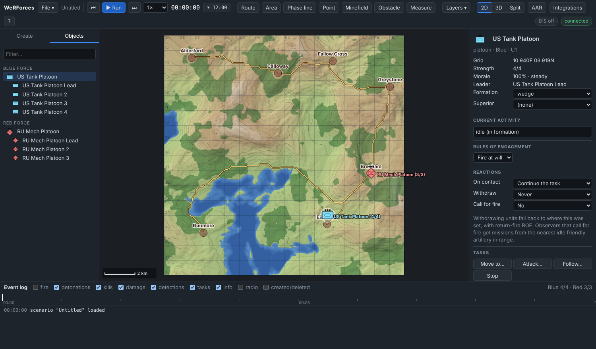
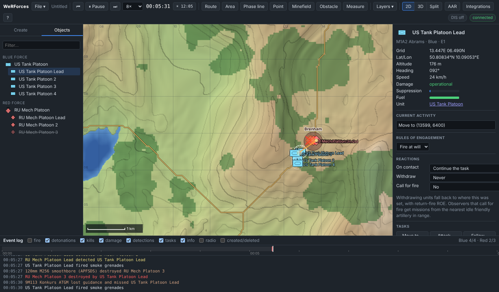

# Tutorial 1: Your first engagement

**Time:** 10 minutes · **You will learn:** placing units, giving a move order,
running time, reading the map and event log, rewinding.

You will set a US tank platoon against a Russian mechanised platoon on the
default terrain and watch the fight.

## 1. Start with an empty scenario

```bash
npm start
```

Open http://127.0.0.1:8080. The scenario name in the toolbar is **Untitled** and
the map is empty apart from terrain:

- brown circles are towns, and yellow lines are roads;
- dark green is forest and blue is water;
- the grid is 1 km.

Move the mouse over the map. The readout in the bottom-right corner shows the
**grid** (km east / km north), latitude/longitude, elevation and ground type.
This tutorial gives positions as grid references like **10.9E 4.0N**.

## 2. Place the Blue platoon

1. In the left panel, **Create** tab, make sure **Blue** is selected.
2. Under **Units**, click **US Tank Platoon** (4× M1A2 Abrams).
3. Click the map just north of the town of **Eastwick**, at about **10.9E 4.0N**.

Four tanks appear in a **wedge**. When zoomed out they show as one platoon
symbol (••• above the frame means *platoon*), labelled *US Tank Platoon (4/4)*.

## 3. Place the Red platoon

1. Click **Red** in the force selector. The palette switches to Russian equipment.
2. Click **RU Mech Platoon** (3× BMP-2).
3. Click on the town of **Brenham**, about **13.8E 6.8N**, 4–5 km north-east of
   your tanks.

Red symbols are diamonds. A BMP-2 has a 30 mm cannon and Konkurs anti-tank
missiles, so it is dangerous to tanks at long range.

## 4. Look at what you made

Open the **Objects** tab. It lists both units and their members. Click
**US Tank Platoon**. The inspector on the right shows:

- **Strength 4/4**, **Morale 100% · steady**, the **Leader**, and **Formation:
  wedge**;
- **Current activity: idle (in formation)**;
- **Rules of engagement: Fire at will**;
- the members. ★ marks the leader.



Click one of the tanks (in the tree or on the map) to see its **Weapons**
(*120mm M256 smoothbore (APFSDS) — 40/40 · 4.0 km* and a 7.62 mm machine gun)
and **Sensors** (*Vehicle thermal sight, Unaided eye*; the thermal sight sees
4.5 km in a 120° arc ahead).

## 5. Save, so you can rewind to this point

**File → Save on server…**, enter `first-engagement`, and press OK. Saving does two
things:

- it writes `scenarios/first-engagement.json`;
- it makes this state the **rewind point**, so ⏮ comes back here.

## 6. Give a move order

1. Select **US Tank Platoon** (click its symbol).
2. **Right-click the ground just south-west of Brenham**, at about **13.6E 6.4N**,
   and choose **Move here**. *Current activity* shows *Move to (13600, 6400)*.

   Don't stop much further back: around 13.4E 6.4N the tanks end up deep in the
   woods, where the canopy blocks the view of Brenham and there is usually no
   fight at all.

   The menu depends on what is under the cursor. Right-clicking the Red platoon's
   symbol offers **Attack RU Mech Platoon Lead** and **Follow RU Mech Platoon
   Lead** instead (Attack is covered in step 9).
3. Open **Layers ▾** and make sure **Planned paths** is ticked. A dashed white
   line shows the route the platoon leader will drive. It follows roads where
   that is faster and avoids water and steep slopes.

## 7. Run it

1. Set the speed to **8×** (next to the clock).
2. Press **Space** (or ▶ **Run**).

What to look for:

- **Movement.** The leader drives the route and the other three keep the wedge
  on it. Zoom in with the wheel to see the individual tanks.
- **Contacts.** With a tank selected, yellow lines run to everything it
  detects. A red line marks its current target. Contacts appear when there is
  line of sight, inside the sensor's range and field of view. Forest blocks
  sight lines that pass through more than 150 m of it.
- **Fire.** Shots appear as yellow tracers; hits as orange flashes, misses as
  grey puffs.
- **Event log.** *X detected Y*, then detonations, damage (*mobility kill*,
  *firepower kill*) and kills. A Konkurs is wire guided: if its BMP is destroyed,
  or the tank it is aimed at hides behind its own smoke grenades (*… fired smoke
  grenades*), the log shows *9M113 Konkurs ATGM lost guidance and missed*. A
  platoon that loses too much *breaks and is falling back*. Tick **fire** in the
  log header to see every shot, and **radio** for the units' contact reports.
  The counts on the right (*Blue 4/4 · Red 3/3*) update as vehicles are lost.



The meeting engagement usually starts five to six simulated minutes in, when
the tanks get within about 500 m of the BMPs and in sight of them. **Your result will
differ** from anyone else's, because exact positions matter. In one run of this
setup (Blue at 10.9E 4.0N, Red at 13.8E 6.8N) the lead tank destroyed a BMP at
5:27. The other two fired Konkurs missiles at it, but it fired its smoke
grenades and both missiles lost guidance. It destroyed a second BMP at 5:34,
the Red platoon broke and began to fall back, and the last BMP was destroyed at
5:40. Final count: *Blue 4/4 · Red 0/3*. Starting a hundred metres away gives
different times, and sometimes a BMP immobilised before it is destroyed, but
in our tries the tanks always won without loss.

> Tip: click **3D** (or **Split**) during the fight, select a tank and tick
> **Follow selected**.

## 8. Look at the aftermath

Click a surviving tank:

- **Damage** may show a *mobility kill* (it can still shoot) or a *firepower
  kill* (it can still move);
- **Weapons** shows the rounds it fired;
- if its leader was destroyed, the event log shows *… lost, … takes command*:
  the next tank took over the platoon and carried on with the move.

## 9. Rewind and try something else

Press ⏮ (confirm). Everything returns to the state you saved in step 5. Try one
of these:

- **Attack instead of move.** Select the platoon, right-click a BMP and choose
  **Attack *name***. Every tank closes to 80 % of its gun range with line of
  sight, then stops and fires.
- **Hold fire.** Set Red's ROE to **Hold fire** (select the Red platoon → *Rules
  of engagement*). Red will not shoot even when it sees you.
- **Bring air support.** Switch to **Blue** and place an **Apache Team**. Then
  select it, right-click Brenham and choose **Move here**. Its Hellfires outrange
  the BMPs.

## What you learned

- **Placing.** Units come from the **Create** palette and are placed in formation.
- **Tasking.** A unit is tasked as a whole (right-click → *Move here*), and
  followers keep formation on the leader.
- **Watching.** Detection needs line of sight and sensor coverage, and combat
  is probabilistic.
- **Saving and rewinding.** **Save on server** sets the rewind point, and ⏮
  returns to it.

**Next:** [Tutorial 2: Routes, plans and conditions](02-routes-plans-and-conditions.md).
