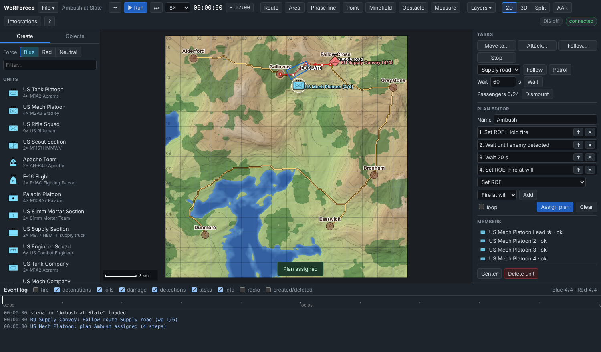
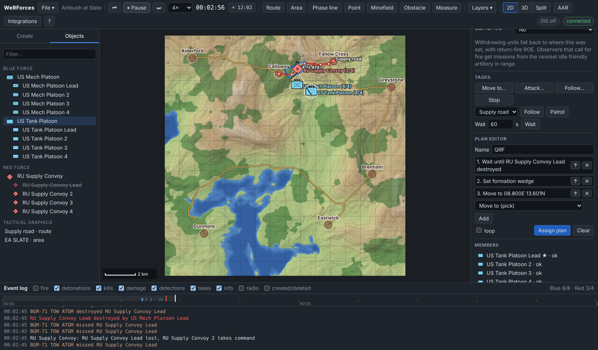

# Tutorial 2: Routes, plans and conditions

**Time:** 20 minutes · **You will learn:** drawing routes and areas, *Follow
route*, ROE, multi-step plans with *wait until* triggers, and a reserve that
launches when an event happens.

The story: a Russian supply convoy will drive the road from **Fallow Cross** west
to **Calloway**. A US mechanised platoon waits in ambush south of the road and
holds fire until the convoy is close. A US tank platoon in reserve moves up as
soon as the convoy's lead vehicle is destroyed.

All positions are on the default terrain. Watch the cursor readout to find them.

## 1. New scenario on the default terrain

**File → New scenario**. Name it `Ambush at Slate`, leave **Keep terrain**
ticked, and press **Create**.

## 2. Draw the convoy's route (Red)

1. Select **Red** in the Create tab. Graphics take the selected force's colour.
2. Click **Route** in the toolbar.
3. Click these points in order. They follow the road; a few metres off is fine.

   | # | Grid | Where |
   | --- | --- | --- |
   | 1 | 11.2E 14.3N | Fallow Cross |
   | 2 | 10.9E 14.1N | |
   | 3 | 10.35E 14.05N | |
   | 4 | 9.3E 14.15N | |
   | 5 | 8.45E 13.4N | |
   | 6 | 7.6E 13.45N | Calloway |

4. Press **Enter** (or double-click) to finish. The route is selected. Rename it
   **Supply road** by clicking its name in the inspector, typing, and pressing
   Enter.

## 3. Draw the engagement area (Blue)

1. Select **Blue**, then click **Area**.
2. Click **9.3E 14.3N → 8.0E 13.7N → 8.3E 13.1N → 9.5E 13.8N** and press **Enter**.
3. Rename it **EA SLATE**.

EA SLATE is the stretch of road the ambush covers. It is drawn here for clarity.
Areas are also what the plan condition *Wait until in area* checks.

## 4. Place and task the convoy

1. Select **Red**, then **Units → RU Supply Convoy** (a BRDM-2 scout car leading
   three Ural trucks). Click **Fallow Cross (11.2E 14.3N)**.
2. With the convoy selected, set **Rules of engagement → Return fire**. The
   BRDM's machine gun will only answer if it is shot at.
3. In **Tasks**, choose **Supply road** in the route picker and press **Follow**.

The convoy follows the route in **column**. Note the lead vehicle's name
(*RU Supply Convoy Lead*). The reserve will watch for it.

## 5. Place the ambush (Blue)

1. Select **Blue**, then **Units → US Mech Platoon** (4× M2A3 Bradley). Click
   **8.8E 12.7N**, on open ground about 800 m south of the road's bend.
   Units are placed facing north, so the road is inside the Bradleys' 120°
   thermal sights.
2. With the platoon selected, type `Ambush` in the plan editor's **Name** field,
   then build the plan:

   | Step | Choose | Value |
   | --- | --- | --- |
   | 1 | Set ROE | Hold fire |
   | 2 | Wait until enemy detected | |
   | 3 | Wait (seconds) | 20 |
   | 4 | Set ROE | Fire at will |

   For each step, pick the type, set the value, and press **Add**.
   

3. Press **Assign plan**. *Current activity* shows *Ambush 1/4: Set ROE holdFire*,
   and the plan advances when the clock runs.

Why wait 20 s? Holding fire lets the convoy close into the kill zone. Hit
probability drops with range (see [Concepts](../concepts.md#combat-and-damage)),
and the trucks behind the lead are in view by then.

## 6. Place the reserve

1. Still Blue: **Units → US Tank Platoon**. Click **9.8E 12.2N**, behind a ridge
   south-east of the ambush.
2. Plan editor, named `QRF`:

   | Step | Choose | Value |
   | --- | --- | --- |
   | 1 | Wait until destroyed (pick) | then click the **convoy's lead vehicle** (zoom in and click the first symbol of the convoy; click the unit symbol to use its current leader) |
   | 2 | Set formation | wedge |
   | 3 | Move to (pick) | then click **8.8E 13.6N** (beside the road) |

3. **Assign plan**.

## 7. Save and run

1. **File → Save on server…** as `ambush-at-slate`. This is now the rewind point.
2. Speed **4×**, then **Run**.
3. Select the Bradley platoon and watch *Current activity*.

What happens (times are simulation time):

| Time | What you see |
| --- | --- |
| ~2:21 | The convoy comes round the bend. *US Mech Platoon 2 detected RU Supply Convoy Lead* (and the BRDM spots the Bradleys at the same moment, but holds its fire). The plan moves to step 3 |
| ~2:41 | The 20 s are up: *US Mech Platoon: plan Ambush complete*, ROE is now fire at will, and the Bradleys fire TOWs at about 1.2 km. Being fired at, the BRDM answers with its heavy machine gun |
| ~2:45 | *RU Supply Convoy Lead destroyed*. The reserve's condition is met, so the tank platoon forms a wedge and moves north. The BRDM has just destroyed *US Mech Platoon 2*, and that Bradley's TOW *lost guidance and missed* |
| 3:00–3:50 | The trucks drive on west towards Calloway and are destroyed one by one; each time, the next vehicle takes command and carries on along the route. When the third vehicle is lost (3:40) the convoy *breaks and is falling back*, too late: in our run a TOW immobilised the last truck at 3:44, and the arriving tanks finished it at 3:47 from about 1.3 km |

In our run the convoy was destroyed for the loss of one Bradley, hit by the
BRDM's heavy machine gun. Your results will vary with exact positions: in
another run, with the units placed a few metres differently, both BRDM bursts
missed and no Bradley was lost.

## 8. Experiment

Rewind (⏮) between experiments.

- **No patience.** Remove the 20 s wait. The Bradleys open fire at the first
  sighting and destroy the BRDM at 2:26, while the trucks are still out of view.
  The trucks then drive into the kill zone one at a time; in our run the
  Bradleys destroyed two of them (2:44 and 3:03), and the last one broke off,
  fell back out of sight north of the road and survived.
- **Make the convoy fight.** Set its ROE to **Fire at will**.
- **Loop a patrol.** Give the convoy **Patrol** instead of Follow. An open route
  is driven back and forth; a closed one (last point on the first) loops.
- **Speed control.** Add *Set speed (km/h) 25* as the convoy's first plan step,
  then its task as the second step.

## How plans work (recap)

- Steps run **in order**. *Set …* steps are instant. Task steps wait until the
  task finishes. *Wait until …* steps wait for their condition.
- **Assigning a task directly replaces the plan.** To change a plan, edit it and
  press **Assign plan** again. The draft stays in the editor.
- A plan runs one step at a time, so it cannot react while a task is running.
  To react while moving, use **ROE** (units fire on the move), **Reactions** in
  the inspector (for example *On contact: Halt and fight*), or split a route into
  legs separated by *wait until* steps.

Conditions: time, in area (the entity, or its unit's leader, is inside an area),
enemy detected, under fire (shot at in the last 15 s), entity destroyed, enemy in
area (a hostile is inside an area), and strength, fuel or ammunition below a
percentage. See
[Concepts → Plans](../concepts.md#plans).

**Next:** [Tutorial 3: Building and sharing a scenario](03-building-a-scenario.md).
