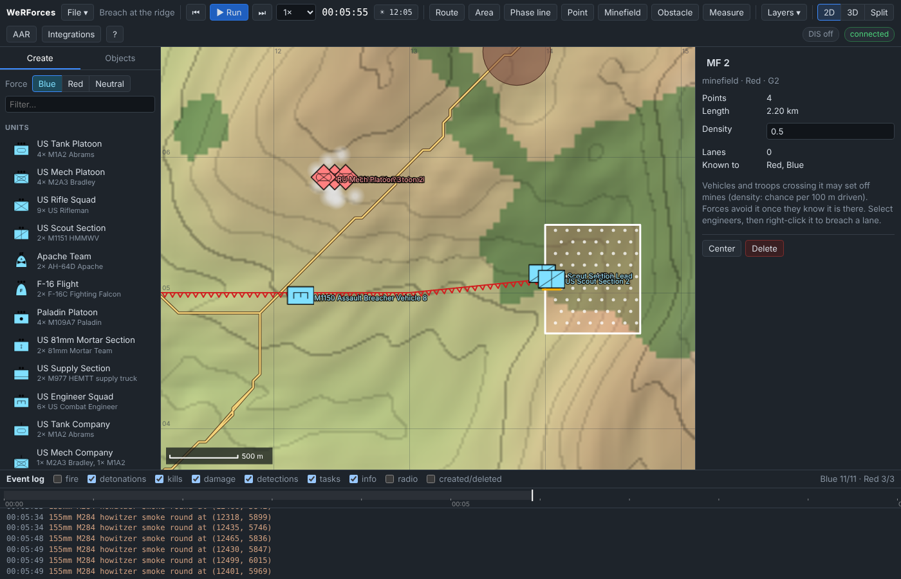
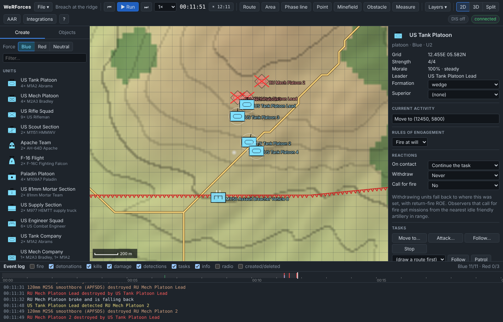

# Tutorial 13: Obstacles, smoke and breaching

**Time:** 25 minutes · **You will learn:** drawing minefields and obstacle lines,
how forces discover minefields, breaching a lane with engineers, screening with
smoke, and moving armour through the lane; then the same orders over REST and MCP.

The scenario: Red holds the ridge south-west of **Brenham** with a BMP platoon.
In front of it runs a 5 km anti-tank ditch, and the gap at its east end is
mined. Blue has a tank platoon, an M1150 Assault Breacher Vehicle, a scout
section and a Paladin platoon, all waiting out of sight in the dip south of the
ridge.

Everything below was run on the default terrain. The simulation is
deterministic, so if you give the same orders at the same simulated times you
get the same results. In the GUI you will click a few seconds earlier or later,
so expect the times in your log to differ a little from the ones quoted here.

## 1. Draw Red's obstacles

Start the server (`npm start`), open <http://127.0.0.1:8080> and choose
**File → New scenario** with the default terrain.

1. In the **Create** tab, click **Red**. The drawing tools draw graphics for the
   force selected here.
2. Click **Obstacle** in the toolbar and click four points: **9.0E 5.3N**,
   **11.0E 5.0N**, **13.0E 5.0N** and **14.0E 5.1N**. Double-click on the last
   point (or press Enter) to finish. This draws the ditch, *OBST 1*: a red line with
   teeth on the map.
3. Click **Minefield** and draw a box over the gap at the east end of the ditch:
   **14.0E 4.7N**, **14.7E 4.7N**, **14.7E 5.5N**, **14.0E 5.5N**. This is *MF 2*.
4. Place an **RU Mech Platoon** (3× BMP-2) at **12.45E 6.2N**. Then right-click
   **12.45E 5.85N** and choose **Defend here**. The BMPs move 350 m south onto the
   forward edge of the ridge and face the way they moved. Defending is covered
   in [Tutorial 15](15-command-tactics-and-analysis.md).

Click the minefield. The inspector shows **Density 0.5**, **Lanes 0** and
**Known to: Red**:

- **Density** is the mine risk. Each metre a vehicle or soldier moves through the
  field outside a lane can set off a mine, and at 0.5 the chance comes to about
  40 % per 100 m driven (1 − e^−0.5). At 1.0 it is about 63 %, and at 0.2 about 18 %. A mine
  usually immobilises an armoured vehicle (10 % kill, 75 % mobility kill). It
  kills a soft vehicle 60 % of the time and a soldier 50 % of the time.
- **Known to** lists the forces whose route planning avoids the field. A
  minefield is known to the force that laid it. Other forces learn of it only
  when one of their vehicles or soldiers sets off a mine in it.

An obstacle line can't be crossed by vehicles at all. Infantry climb through it,
slowly.

## 2. Place Blue

Click **Blue** and place, in this order:

| What | Where |
| --- | --- |
| **US Tank Platoon** | 11.9E 2.5N |
| **M1150 Assault Breacher Vehicle** (under *Ground vehicles*) | 12.2E 2.7N |
| **US Scout Section** | 12.7E 2.6N |
| **Paladin Platoon** | 10.6E 1.8N |

The BMPs on the ridge can see almost the whole slope down to the dip at 2.5N,
and their Konkurs missiles reach 4 km. Blue starts in the only dead ground.

To see what the tanks would do on their own, select the tank platoon,
right-click the ridge at **12.45E 5.8N**, choose **Move here** and press ⏭ to
step one second (a route is planned when the order starts to run). The dashed
planned path (**Layers → Planned paths**) runs 5.2 km east, round the end of
the ditch and straight through the minefield, because Blue does not know the
minefield is there. Press **Ctrl+Z**. This undoes the order, and the clock goes
back to 0:00 with it.

## 3. Smoke first

Red will kill anything that climbs out of the dip in daylight. Without smoke,
when the M1150 and the scouts moved off at 0:45 in a test run, this happened:

```
00:01:15 detonation 9M113 Konkurs ATGM destroyed US Scout Section Lead
...
00:01:22 info       M1150 Assault Breacher Vehicle 8 fired smoke grenades
00:01:26 info       M1150 Assault Breacher Vehicle 8 fired smoke grenades
00:01:36 detonation 9M113 Konkurs ATGM destroyed M1150 Assault Breacher Vehicle 8
...
00:02:02 destroyed  US Scout Section 2 destroyed by RU Mech Platoon 3
```

The M1150 fires its own smoke grenades when a missile is launched at it, but it
carries only two salvoes.

So, at 0:00 with the simulation paused:

1. Select the **Paladin Platoon** and right-click the BMPs' defensive position,
   on the ground at **12.45E 5.8N**. Choose **Smoke screen here (2 rounds)**.
   (Right-clicking a BMP itself offers HE fire missions, not smoke.)
2. Press **Run** and watch the log. The guns take 20 s to lay. From 0:33 the
   155 mm smoke rounds land around the BMPs: *155mm M284 howitzer smoke round at
   (12508, 5723)*. Each round makes a 75 m cloud that lasts three minutes.
   (Mortars work too: 81 mm smoke makes 40 m clouds that last two minutes.)

Select a BMP: its **Contacts** list stays empty for as long as the smoke covers
it. Smoke blocks every optical and thermal sight line through it. Only radar
sees through.

The smoke wears off, so fire the same smoke mission again at **2:30**, **5:00** and
**7:30**.

## 4. Find the minefield, breach the ditch

At about **0:45**, pause and give two orders:

1. **Scouts.** Select the **US Scout Section**, right-click **12.45E 5.8N** and
   choose **Move here**. Their path runs east round the ditch, through the gap.
2. **Breach.** Select the **M1150**, right-click the ditch line near **12.2E 5.0N**
   and choose **Breach a lane through OBST 1**. (Only engineers get this item:
   the M1150 and the US/RU engineer and sapper squads.)

Run. In the test run:

```
00:00:45 task       US Scout Section: Move to (12450, 5800)
00:00:45 task       M1150 Assault Breacher Vehicle 8: Breach OBST 1
...
00:04:59 detonation US Scout Section 2 struck a mine in MF 2
00:04:59 damaged    US Scout Section 2 suffered a mobility kill
```

Select the scouts and press **Stop**, or the surviving HMMWV drives on alone
(it is already through the gap). Click the minefield: **Known to: Red, Blue**.
Blue's route planning now treats the field as almost impassable and keeps a
margin from it, and anything of Blue's that is moving plans its route again at
once. A tank route to the ridge no longer goes east: it goes 7.7 km round the
*west* end of the ditch instead (section 7 shows how to ask the route planner).



Meanwhile the M1150 has driven to the ditch and stopped just short of it. Its
**Current activity** counts the work; at 6:00 it read *Breach OBST 1: 59 s of
work*. An M1150 needs 90 s of work per lane and a squad of engineers 240 s.
Work goes up to five times slower while the engineers are suppressed.

```
00:06:31 task       M1150 Assault Breacher Vehicle 8 breached a lane through OBST 1
```

The lane is a gap 30 m wide in the ditch at 12.2E, shown on the map. The ditch's
inspector now says **Lanes 1**.

## 5. Through the lane

Tank routes now go through the lane. A planned move to the ridge is 3.4 km long:
straight up to 12.2E 4.98N, through the lane, and on to the objective.

At **6:35**, select the **US Tank Platoon**, right-click **12.45E 5.8N** and
choose **Move here**:

```
00:06:35 task       US Tank Platoon: Move to (12450, 5800)
```

The leader plans its route through the lane. The other three keep their places
in the wedge, and when the ditch lies between a tank and its place, that tank
finds its own way through the lane and then closes up again.

Units that are already moving don't need a new order. In another run the
platoon was sent to the ridge at 5:10, when the only known way was the 7.7 km
detour round the west end. When the lane opened at 6:31, the tanks planned
again and turned for the lane.

The leader drives through the lane at about 10:30, and the others follow it
through by 11:10. The last smoke mission (fired at 7:30) clears just as they
reach the top of the ridge:

```
00:11:18 detected   RU Mech Platoon 3 detected US Tank Platoon Lead
...
00:11:18 info       US Tank Platoon Lead fired smoke grenades
...
00:11:18 destroyed  RU Mech Platoon 3 destroyed by US Tank Platoon Lead
00:11:19 info       US Tank Platoon 3 fired smoke grenades
...
00:11:21 detonation 9M113 Konkurs ATGM lost guidance and missed US Tank Platoon Lead
00:11:21 detonation 9M113 Konkurs ATGM lost guidance and missed US Tank Platoon 3
...
00:11:31 destroyed  RU Mech Platoon Lead destroyed by US Tank Platoon Lead
00:11:32 info       RU Mech Platoon broke and is falling back
...
00:11:49 destroyed  RU Mech Platoon 2 destroyed by US Tank Platoon Lead
```

Which BMP dies first, and to which tank, depends on the exact second you give
the order. In seven more runs with the order given between 6:33 and 7:00, all
three BMPs were destroyed by 12:47 every time, but Konkurs missiles destroyed a
tank in two of those runs and damaged one in two others.

At 15:00 the counts read **Blue 11/11 · Red 0/3**. In this run the minefield
cost one HMMWV its mobility, and nothing else on the Blue side was hit.



## 6. What just happened

- **Obstacles shape routes.** Vehicle routes never cross an obstacle line except
  through a lane. Infantry may climb through it, slowly.
- **Minefields are found the hard way.** A force's routes ignore a minefield it
  doesn't know about. The first mine strike makes the field known (so does
  sending engineers to breach it). From then on that force's routes keep clear
  of it if there is any other way, and units already on the move plan again.
- **Smoke buys time, not safety.** A smoke cloud hides everything behind it in
  both directions. The BMPs saw nothing for ten minutes, and the tanks could
  not see them either until the last smoke cleared.
- **Lanes are narrow.** A lane is 30 m wide, so a unit files through it one
  vehicle at a time. Formation followers whose place is across the obstacle
  find their own way through the lane.

## 7. The same orders over REST and MCP

The same orders work through the REST API, with the server on its default port.

Draw the ditch and the minefield as Red (`force: 2`). `density` is optional
(default 0.5, up to 3):

```bash
curl -X POST localhost:8080/api/v1/graphics -H 'Content-Type: application/json' \
  -d '{"kind": "obstacle", "force": 2, "points": [{"x": 9000, "y": 5300}, {"x": 11000, "y": 5000}, {"x": 13000, "y": 5000}, {"x": 14000, "y": 5100}]}'
curl -X POST localhost:8080/api/v1/graphics -H 'Content-Type: application/json' \
  -d '{"kind": "minefield", "force": 2, "density": 0.5, "points": [{"x": 14000, "y": 4700}, {"x": 14700, "y": 4700}, {"x": 14700, "y": 5500}, {"x": 14000, "y": 5500}]}'
```

Each response is the new graphic. After the scouts struck a mine, `GET
/api/v1/graphics/G2` returned:

```json
{"id":"G2","kind":"minefield","name":"MF 2","points":[{"x":14000,"y":4700},{"x":14700,"y":4700},{"x":14700,"y":5500},{"x":14000,"y":5500}],"force":2,"knownBy":[1]}
```

and after the breach, the ditch carried its lane:

```json
{"id":"G1","kind":"obstacle","name":"OBST 1","points":[...],"force":2,"lanes":[{"from":{"x":12200,"y":4980},"to":{"x":12200,"y":5040}}]}
```

Breach and smoke are ordinary tasks. Here the M1150 is `E8` and the Paladin
platoon `U4`:

```bash
curl -X POST localhost:8080/api/v1/entities/E8/task -H 'Content-Type: application/json' \
  -d '{"type": "breach", "graphicId": "G1"}'
curl -X POST localhost:8080/api/v1/units/U4/task -H 'Content-Type: application/json' \
  -d '{"type": "fireMission", "target": {"x": 12450, "y": 5800}, "rounds": 2, "radius": 60, "smoke": true}'
```

To compare routes, ask the route planner as a force. It plans the way that
force's units would:

```bash
curl -X POST localhost:8080/api/v1/terrain/route -H 'Content-Type: application/json' \
  -d '{"from": {"x": 11900, "y": 2500}, "to": {"x": 12450, "y": 5800}, "force": 1, "offroadFactor": 0.7}'
```

At the start this returned a length of 5164 m via (14050, 5100), through the
gap. Once the minefield was known it returned 7694 m via (8950, 5200), round the
west end. After the breach it returned 3409 m via (12200, 4980) and
(12200, 5040), through the lane.

Over **MCP**, an agent uses `create_graphic` with `kind: "minefield"` or
`"obstacle"` (and `density`), and `assign_task` with `type: "breach"` and
`graphicId`, or `type: "fireMission"` with `to`, `rounds`, `radius` and `smoke:
true`. See [MCP tools](../reference/mcp-tools.md).

## 8. Things to try

- **Engineers on foot.** Use a **US Engineer Squad** instead of the M1150. It
  takes 240 s to breach, and its soldiers are far easier to hurt.
- **Breach the minefield.** Order the engineers to breach *MF 2*. They open a
  lane from the edge nearest to them, straight across. The order alone makes
  the minefield known to Blue, so no one has to find it by driving into it.
- **Mortars instead of guns.** Replace the Paladins with a **US 81mm Mortar
  Section** at 11.4E 2.6N. Its clouds are smaller and shorter-lived, so you
  need to fire more often.
- **Wind.** Set a wind in **File → Simulation settings** and watch the smoke
  drift off the BMPs ([Tutorial 14](14-night-weather-and-supply.md)).

See also [Concepts → Smoke, minefields, obstacles and engineers](../concepts.md#smoke-minefields-obstacles-and-engineers).

**Next:** [Tutorial 14: Night, weather and supply](14-night-weather-and-supply.md).
