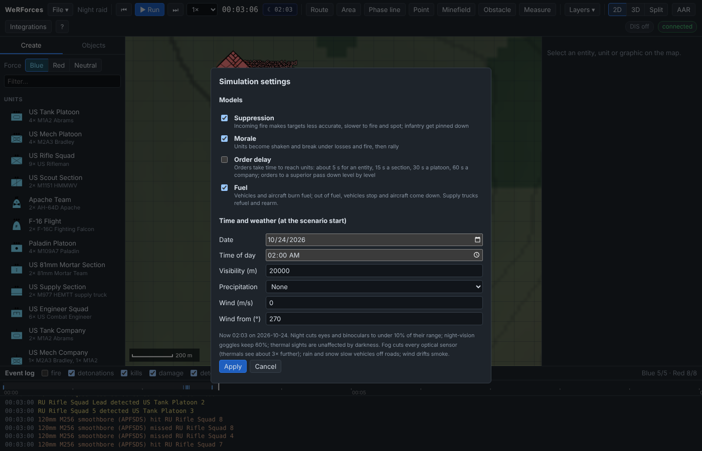
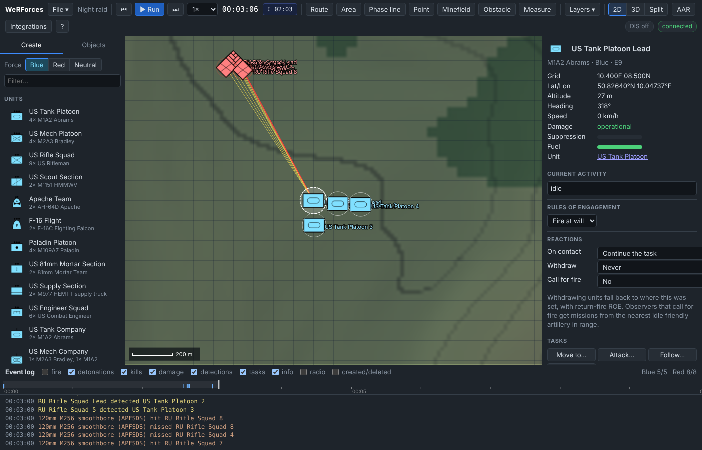

# Tutorial 14: Night, weather and supply

**Time:** 25 minutes · **You will learn:** setting the time of day and the
weather, what darkness does to each kind of sensor, muzzle flashes, rain, fog
and wind, fuel gauges, resupplying from a supply truck, plans that react to
fuel and ammunition, and the fuel rule.

You will fight a small night action: a US tank platoon with thermal sights
against a Russian rifle squad that has only binoculars. Then you will refuel
and rearm the tanks, and keep a helicopter on station until its fuel runs low.

The simulation is deterministic. The results quoted here come from runs of
exactly these steps. In the GUI you will give orders a few seconds earlier or
later, so your times will differ a little.

## 1. Set the clock and the weather

Start the server (`npm start`), open <http://127.0.0.1:8080> and choose
**File → New scenario** with the default terrain.

Click the clock chip next to the simulation time (it shows *☀ 12:00*), or
choose **File → Simulation settings…**. Under **Time and weather (at the scenario
start)** set:

- **Date** 2026-10-24
- **Time of day** 02:00

Leave **Visibility (m)** at 20000, **Precipitation** at *None* and **Wind** at
0, and press **Apply**. The chip now reads **☾ 02:00**, and the map and 3D view
darken. Hover over the chip to see the details: *2026-10-24 02:00 local · night ·
sun -44.8° · light 8% · visibility 20 km*.



The same through the REST API:

```bash
curl -X PUT localhost:8080/api/v1/simulation/environment -H 'Content-Type: application/json' \
  -d '{"date": "2026-10-24", "time": 2}'
```

```json
{"date":"2026-10-24","time":2,"visibility":20000,"precipitation":"none","windSpeed":0,"windFrom":270,"localDate":"2026-10-24","localTime":"02:00","sunAltitude":-44.8,"light":0.08,"period":"night"}
```

Fields you leave out keep their values. Over MCP the tool is
`set_environment`, with the same fields.

`time` is the local solar time **when the scenario starts**, and the clock runs
on with the simulation. The light depends on how high the sun is at the
terrain's latitude on that date. On 24 October at the default terrain's 50.75°N:

| Local time | Sun | Light | Period |
| --- | --- | --- | --- |
| 16:30 | 3.8° | 100 % | day |
| 17:00 | −0.6° | 93 % | twilight |
| 17:30 | −5.1° | 40 % | twilight |
| 18:00 | −9.8° | 16 % | twilight |
| 18:30 | −14.5° | 8 % | night |

A scenario that starts at 17:00 and runs for 90 minutes therefore ends in the
dark.

## 2. Who sees what at night

The light level scales the range of eyes and binoculars. Night-vision goggles
never drop below 60 % of their range. Thermal sights don't care about light at
all. Here are the effective ranges for the catalog's sensors, from the
simulation's own formula:

| Conditions | Eye | Binoculars | NVG | Vehicle thermal sight |
| --- | --- | --- | --- | --- |
| Day, clear | 1500 m | 3000 m | 1000 m | 4500 m |
| Night (light 8 %) | 120 m | 240 m | 600 m | 4500 m |
| Night, rain | 96 m | 192 m | 480 m | 3600 m |
| Day, fog (visibility 400 m) | 400 m | 400 m | 400 m | 1200 m |
| Day, heavy rain | 825 m | 1650 m | 550 m | 2700 m |

The kit matters:

- **M1A2, M2A3, M1150, T-72B3, BMP-2** have a thermal sight (4.5 km, 120° ahead)
  and the unaided eye.
- **US Rifleman, US Combat Engineer, HMMWV** have binoculars and NVGs (1 km in a
  40° arc).
- **Russian Rifleman, RU Sapper, BRDM-2** have binoculars only.

## 3. The night fight

Place, in this order:

1. **Red:** an **RU Rifle Squad** at **10.0E 9.2N**.
2. **Blue:** a **US Tank Platoon** at **11.4E 7.4N**, 2.3 km to the south-east. In
   the inspector, set **Rules of engagement → Hold fire**.
3. **Blue:** an **M977 HEMTT supply truck** (under *Ground vehicles*) at
   **11.8E 7.0N**, behind the tanks.

Press **Run** at 1×. In the first second the tanks report every rifleman:

```
00:00:00 detected   US Tank Platoon 4 detected RU Rifle Squad Lead
00:00:00 detected   US Tank Platoon 4 detected RU Rifle Squad 2
...
00:00:00 detected   US Tank Platoon 3 detected RU Rifle Squad 5
```

Select a rifleman: **Contacts: none**. With binoculars cut to 240 m, the squad
can't see tanks 2.3 km away. The tanks each hold 8 contacts, the riflemen 0.

In daylight the same setup goes the other way. With the time of day left at
12:00, the squad sees the tanks at once:

```
00:00:00 detected   RU Rifle Squad Lead detected US Tank Platoon Lead
00:00:00 detected   RU Rifle Squad Lead detected US Tank Platoon 2
00:00:00 detected   RU Rifle Squad 2 detected US Tank Platoon 3
```

## 4. Muzzle flashes

At **0:30**, select the tank platoon, right-click **10.4E 8.5N** (800 m from the
squad) and choose **Move here**. The tanks arrive at about 2:51 and keep their
thermal contacts. At 2:59 the riflemen still have no contacts: a tank 800 m away
in the dark is invisible to them.

At **3:00**, set the platoon's **Rules of engagement** back to **Fire at will**.
The tanks open fire, and in the same second the squad sees them:

```
00:03:00 detected   RU Rifle Squad Lead detected US Tank Platoon Lead
00:03:00 detected   RU Rifle Squad Lead detected US Tank Platoon 2
00:03:00 detected   RU Rifle Squad 5 detected US Tank Platoon 3
...
00:03:13 destroyed  RU Rifle Squad 4 destroyed by US Tank Platoon 3
...
00:03:24 info       RU Rifle Squad broke and is falling back
...
00:03:32 destroyed  RU Rifle Squad Lead destroyed by US Tank Platoon 3
```

For 5 s after a weapon fires, a sensor sees the shooter as if the light were at
least 50 %. That gives binoculars 1.5 km against a firing tank. The riflemen's
weapons reach 500 m, so seeing the tanks does them no good.



## 5. Rain, fog and wind

**Rain and snow** slow movement off roads, by ×0.9 for rain, ×0.75 for heavy rain
and ×0.7 for snow, and leave roads alone. A single M1A2 driving 2.4 km across
open ground (10.4E 7.6N to 10.4E 10.0N) and another driving 6.3 km by road
from Alderford to Calloway took:

| Precipitation | Off-road, 2.4 km | Top speed off-road | By road, 6.3 km |
| --- | --- | --- | --- |
| None | 3:56 | 39.6 km/h | 9:36 |
| Rain | 4:02 | 39.6 km/h | 9:39 |
| Heavy rain | 4:48 | 33.7 km/h | 9:50 |
| Snow | 5:08 | 31.4 km/h | 9:55 |

The road drive slows a little too, because it starts and ends in the town
centres, a few hundred metres off the road.

The tank cruises at 39.6 km/h, a little below what open ground allows it, so
light rain hardly shows. Heavy rain and snow pull the off-road limit below its
cruising speed.

**Fog** is a short **Visibility**. It caps every optical sensor at the
visibility, and thermals at three times the visibility (see the table in
section 2). Precipitation also shortens sensor ranges.

**Wind** drifts smoke at the wind speed, towards the opposite of where it blows
from. In a new scenario with **Wind (m/s)** 4 and **Wind from (°)** 270 (a
westerly), a **US 81mm Mortar Section** at 11.4E 7.4N fired a smoke screen at
10.4E 9.55N. Its first round landed at (10448, 9552) at 0:31. The cloud had
moved to (10484, 9552) by 0:40, (10564, 9552) by 1:00 and (10724, 9552) by 1:40:
4 m east every second, 240 m a minute. Lay smoke upwind of where you want it.

## 6. Fuel and resupply

Let the night fight run on to **5:00** and pause. Click **US Tank Platoon
Lead**. The inspector has a **Fuel** gauge: hover over it for the percentage
(*100%* here, 0.997 over the API after about 1.5 km of driving). An M1A2 holds
fuel for 426 km. **Weapons** shows the main gun at *34/40*.

The HEMTT's inspector shows **Supplies: 10.0 vehicle loads**. One load is a full
tank of fuel and a full load of every weapon for one vehicle.

Select the tank platoon and right-click the HEMTT. The menu offers **Resupply
from M977 HEMTT supply truck 13**. In the test run the order was given at 5:00:

```
00:05:00 task       US Tank Platoon: Resupply from M977 HEMTT supply truck 13
00:08:00 info       US Tank Platoon 4 resupplied by M977 HEMTT supply truck 13
00:08:08 info       US Tank Platoon 2 resupplied by M977 HEMTT supply truck 13
00:08:08 info       US Tank Platoon 3 resupplied by M977 HEMTT supply truck 13
00:08:17 info       US Tank Platoon Lead resupplied by M977 HEMTT supply truck 13
```

Each tank drives to the truck, halts within 60 m of it and takes on fuel and
ammunition. Supplies only flow while both are halted. All four ended with 40/40
main gun rounds and a full tank, and the truck had 9.84 loads left
(*9.8 vehicle loads* in the inspector). A unit order sends every member that
needs anything. Without a named truck, a resupply order goes to the nearest
friendly supply vehicle with stock left.

Through the API (tank platoon `U2`, truck `E13`):

```bash
curl -X POST localhost:8080/api/v1/units/U2/task -H 'Content-Type: application/json' \
  -d '{"type": "resupply", "supplierId": "E13"}'
```

Over MCP: `assign_task` with `type: "resupply"`, and `targetEntityId` for a
particular truck.

## 7. Plans that watch fuel and ammunition

Two plan steps wait on supply levels, and one goes to get more:

- **Wait until…** *fuel below (%)*: the average fuel of the entity, or of the
  unit's vehicles and aircraft.
- **Wait until…** *ammunition below (%)*: the average over the unit's members of
  each one's ammunition. A member's ammunition is the mean of its weapons, each
  as a fraction of a full load. A tank with 34/40 main gun rounds and an
  untouched machine gun is at (34/40 + 1) / 2 ≈ 93 %.
- **Resupply at the nearest supply vehicle**.

A plan waits at a *Wait until* step but still fights, because engagements don't
depend on tasks. A useful pattern for a unit holding ground is **Wait until…**
*ammunition below (%)* 40, then **Resupply at the nearest supply vehicle**,
then **Move to (pick)** back to its position.

Helicopters burn fuel by the hour, which makes them a quicker example. Choose
**File → New scenario** (a new scenario starts at noon on 21 June again), then
place:

1. an **M977 HEMTT supply truck** at **11.8E 7.0N**;
2. an **AH-64D Apache** (under *Aircraft*) at **11.0E 8.0N**;
3. a second **AH-64D Apache** at **11.2E 8.2N**.

Select the first Apache and build a plan in the **Plan editor**:

| Step | Value |
| --- | --- |
| Wait until… | fuel below (%), 30 |
| Resupply at the nearest supply vehicle | |

Name it *On station*, press **Assign plan**, and run at **32×**. Each Apache can
fly for 2.5 hours, and a helicopter hovering in place burns fuel as fast as one
flying:

```
00:00:00 task       AH-64D Apache 2: plan On station assigned (2 steps)
01:46:26 info       AH-64D Apache 2 resupplied by M977 HEMTT supply truck 1
01:46:26 task       AH-64D Apache 2: plan On station complete
02:00:00 info       AH-64D Apache 3 is low on fuel (20%)
02:30:00 destroyed  AH-64D Apache 3 destroyed by fuel exhaustion
```

The first Apache left station at 30 % (1:45), flew to the truck, set down
beside it, refuelled and went back up to 60 m (the truck went from 10 to 9.65
loads). Helicopters resupply in the field like ground vehicles; fixed-wing
aircraft can't. The second Apache had no plan. It warned at 20 % and came down
when its tank was empty. Out of fuel, ground vehicles just stop where they
are.

Over the API, the plan is:

```json
{"name": "On station", "statements": [
  {"kind": "waitUntil", "condition": {"type": "fuelBelow", "fraction": 0.3}},
  {"kind": "task", "task": {"type": "resupply"}}
]}
```

`ammoBelow` works the same way: `{"type": "ammoBelow", "fraction": 0.4}`.

## 8. The fuel rule

Fuel is an optional part of the model. Untick **Fuel** in **File → Simulation
settings** to turn it off for this scenario. Then nothing burns fuel and the
Fuel gauges disappear. Supply trucks still rearm. Over the API:

```bash
curl -X PUT localhost:8080/api/v1/simulation/rules -H 'Content-Type: application/json' -d '{"fuel": false}'
```

```json
{"suppression":true,"morale":true,"fuel":false,"orderDelay":false}
```

The rules are saved with the scenario, and `set_simulation_rules` does the same
over MCP. Turning a rule off is useful for comparison runs ([Tutorial
15](15-command-tactics-and-analysis.md) shows batch runs).

## What you learned

- **Time and weather** are set for the scenario start, and the clock moves on.
  The sun's altitude gives the light.
- **Darkness** cuts eyes and binoculars to 8 % of their range. NVGs keep 60 %,
  and thermals keep everything. A weapon that fires gives its position away for
  5 s.
- **Rain and snow** slow off-road movement and shorten sensor ranges. **Fog**
  caps them. **Wind** moves smoke.
- **Supply trucks** refuel and rearm units that halt beside them. Plans can wait
  for fuel or ammunition to run low and then resupply.

See also [Concepts → Night and weather](../concepts.md#night-and-weather) and
[Concepts → Fuel, ammunition and resupply](../concepts.md#fuel-ammunition-and-resupply).

**Next:** [Tutorial 15: Command, tactics and analysis](15-command-tactics-and-analysis.md).
