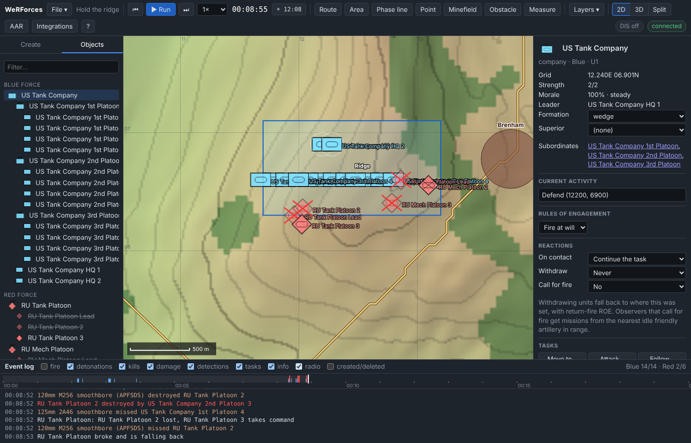
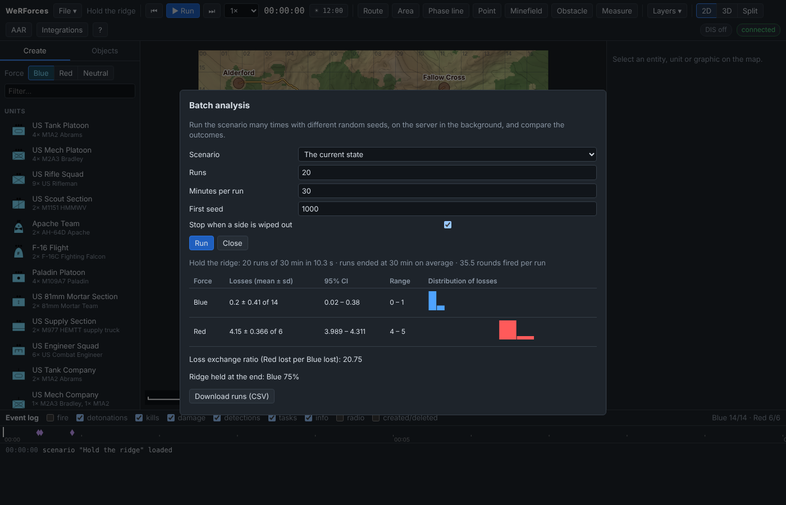

# Tutorial 15: Command, tactics and analysis

**Time:** 30 minutes · **You will learn:** companies and the chain of command,
how orders pass down, Defend and the other tactical tasks, dug-in and hull-down
positions, the order-delay rule, covered routes, multi-select and group orders,
undo and redo, the measure tool, the timeline, Monte Carlo batch analysis, and
exporting the after-action review.

The scenario: a US tank company holds the reverse slope of the ridge
south-west of **Brenham**. A Russian tank platoon and a BMP platoon attack it
from the south.

The simulation is deterministic: the run quoted here comes from giving exactly
these orders, in this order, at 0:00. In the GUI your clicks land a few metres
from the quoted grid references, so expect small differences.

## 1. Turn on order delay

Start the server (`npm start`), open <http://127.0.0.1:8080> and choose
**File → New scenario** with the default terrain. Set its **Name** to *Hold the
ridge*.

Open **File → Simulation settings…**, tick **Order delay** and press **Apply**.
With this rule on, orders take time to reach a unit, depending on its size:
about 5 s for an entity, 15 s for a section, 30 s for a platoon and 60 s for a
company. Each delay varies by ±20 %. An order to a superior arrives at the
superior first, then goes down one level at a time, and each level adds its own
delay. The rule is off by default. Over the API it is:

```bash
curl -X PUT localhost:8080/api/v1/simulation/rules -H 'Content-Type: application/json' -d '{"orderDelay": true}'
```

```json
{"suppression":true,"morale":true,"fuel":true,"orderDelay":true}
```

## 2. A company and its chain of command

Place, in this order:

1. **Blue:** a **US Tank Company** at **12.2E 7.6N**.
2. **Red:** an **RU Tank Platoon** (3× T-72B3) at **12.0E 1.5N**.
3. **Red:** an **RU Mech Platoon** (3× BMP-2) at **12.9E 1.5N**.
4. **Blue:** click **Blue**, then the **Area** tool, and draw a box around the
   ridge: **11.7E 6.3N**, **13.2E 6.3N**, **13.2E 7.1N**, **11.7E 7.1N**. Name it
   *Ridge* in the inspector. Batch runs report who holds it at the end.

The company template builds a headquarters of two M1A2s with three tank platoons
under it, 14 tanks in all. The platoons are named after the company. Open the
**Objects** tab: *US Tank Company* holds *US Tank Company 1st Platoon*, *US Tank
Company 2nd Platoon* and *US Tank Company 3rd Platoon*, each with four tanks
(*US Tank Company 1st Platoon Lead*, *US Tank Company 1st Platoon 2*, …),
followed by *US Tank Company HQ 1* and *HQ 2*. The two HQ tanks stand close
together at 12.2E 7.3N, behind the platoons.

Click the company. Its inspector shows **Superior: (none)** and **Subordinates:
US Tank Company 1st Platoon, US Tank Company 2nd Platoon, US Tank Company 3rd
Platoon**. The company's own **Strength** and **Grid** are those of its HQ tanks
(*2/2* and *12.240E 07.260N*). Click *US Tank Company 1st Platoon*: its
**Superior** is *US Tank Company*. Any unit can be put under another of the same
force with this chooser, or with **Put under …** (section 6).

Orders given to a superior pass down:

- **Move**: every subordinate moves by the same offset, so the company arrives
  in the shape it left in. A company placed at 12.2E 7.6N and ordered to
  11.2E 7.6N sent *US Tank Company 1st Platoon: Move to (11200, 7860)*, *US Tank
  Company 2nd Platoon: Move to (11700, 7360)* and *US Tank Company 3rd Platoon:
  Move to (10700, 7360)*.
- **Defend, Overwatch, Screen, Ambush**: the subordinates spread out in a line
  across the facing, 400 m apart for vehicles and 150 m for infantry. The HQ sits
  behind the line (300 m, or 150 m for infantry).
- **Anything else** (attack, resupply…) goes to every subordinate as given.

A plan step given to a superior lasts until its subordinates have finished too.

## 3. Defend

Select the company, right-click **12.24E 6.6N**, straight south of its HQ, and
choose **Defend here**.

Then give the Red platoons one order together:

1. With the whole map in view, click the RU Tank Platoon and **Shift+click** the
   RU Mech Platoon. Zoomed out this far, the map draws each platoon as one
   symbol, so a click picks the platoon. (Zoomed in, it picks a single
   vehicle.)
2. Zoom in on **12.45E 7.4N** until the scale bar reads 200 m, and right-click
   there, on open ground. Zoomed out, that point is under the company's symbol
   and the menu offers to attack it instead.
3. The menu header says *2 selected*. Choose **Move here (keep formation)**.

Each Red platoon is sent to the point you clicked plus its offset from the
middle of the pair.

The orders are not carried out yet. The event log shows:

```
00:00:00 task       Order to US Tank Company: Defend (12240, 6600) (arrives in 53 s)
00:00:00 task       Order to RU Tank Platoon: Move to (12000, 7373) (arrives in 27 s)
00:00:00 task       Order to RU Mech Platoon: Move to (12900, 7427) (arrives in 29 s)
```

The company's **Current activity** reads *ORDER IN 53 s: Defend (12240, 6600)*.
The **timeline** strip under the log header shows a purple mark for each
order still on its way. Hover over one to read it, or click it to select the
unit.

Choose **File → Save on server…** and save as `hold-the-ridge`. This makes the
current state the rewind point. Then press **Run** (8× is fine) and tick
**radio** in the log header:

```
00:00:27 task       RU Tank Platoon: Move to (12000, 7373)
00:00:27 radio      RU Tank Platoon: wilco, Move to (12000, 7373)
00:00:29 task       RU Mech Platoon: Move to (12900, 7427)
00:00:29 radio      RU Mech Platoon: wilco, Move to (12900, 7427)
00:00:53 task       Order to US Tank Company 2nd Platoon: Defend (12640, 6600) facing 180° (arrives in 27 s)
00:00:53 task       Order to US Tank Company 1st Platoon: Defend (12240, 6600) facing 180° (arrives in 29 s)
00:00:53 task       Order to US Tank Company 3rd Platoon: Defend (11840, 6600) facing 180° (arrives in 33 s)
00:00:53 task       US Tank Company: Defend (12240, 6600) (moving)
00:00:53 radio      US Tank Company: wilco, Defend (12240, 6600)
00:01:20 task       US Tank Company 2nd Platoon: Defend (12640, 6600) (moving)
00:01:20 radio      US Tank Company 2nd Platoon: wilco, Defend (12640, 6600) facing 180°
00:01:22 task       US Tank Company 1st Platoon: Defend (12240, 6600) (moving)
00:01:22 radio      US Tank Company 1st Platoon: wilco, Defend (12240, 6600) facing 180°
00:01:26 task       US Tank Company 3rd Platoon: Defend (11840, 6600) (moving)
00:01:26 radio      US Tank Company 3rd Platoon: wilco, Defend (11840, 6600) facing 180°
```

The company took 53 s to receive the order. It then split it, and each platoon
took another 27–33 s to receive its part. The facing, 180°, is the direction
from the company HQ (its **Grid**, 12.24E 7.26N) to the point you clicked, so
click straight ahead of the HQ in the direction you want the line to face. A
click at 12.45E 6.6N instead would give a line facing 162°, slanting from
south-west to north-east. (REST and MCP take an explicit `facing`.) Each
platoon then deploys its four tanks in a line across that facing, about 107 m
apart.

A vehicle that holds still on a Defend, Overwatch, Screen or Ambush position for
30 s goes **hull-down** (infantry take 90 s to **dig in**). The activity shows
*HULL-DOWN*. The first tanks went hull-down at 2:05, and by 3:35 all 14 were.
A hull-down vehicle that hasn't fired in the last 5 s is half as likely to be
spotted, and hits on it are 40 % less likely to kill (60 % less for troops dug
in). It loses that cover as soon as it moves.

## 4. The fight

Most of the line at 6.6N is behind the crest, out of sight of the slope the Red
platoons climb. Only the 2nd Platoon, at the east end, can see down it. From
2:10 it and the BMPs spot each other about 4 km apart. The BMPs' Konkurs shots
set off the tanks' smoke grenades but hit nothing. The killing starts when the
Red platoons come over the top. With **detections**, **detonations** and
**radio** unticked, the log reads:

```
00:08:20 info       US Tank Company 2nd Platoon Lead fired smoke grenades
00:08:22 destroyed  RU Mech Platoon 3 destroyed by US Tank Company 2nd Platoon 4
00:08:28 info       US Tank Company 2nd Platoon 4 fired smoke grenades
00:08:36 destroyed  RU Tank Platoon Lead destroyed by US Tank Company 1st Platoon Lead
00:08:36 info       RU Tank Platoon: RU Tank Platoon Lead lost, RU Tank Platoon 2 takes command
00:08:38 destroyed  RU Mech Platoon Lead destroyed by US Tank Company 2nd Platoon 4
00:08:39 info       RU Mech Platoon: RU Mech Platoon Lead lost, RU Mech Platoon 2 takes command
00:08:39 info       RU Mech Platoon broke and is falling back
00:08:52 destroyed  RU Tank Platoon 2 destroyed by US Tank Company 2nd Platoon 3
00:08:52 info       RU Tank Platoon: RU Tank Platoon 2 lost, RU Tank Platoon 3 takes command
00:08:53 info       RU Tank Platoon broke and is falling back
00:09:02 info       RU Mech Platoon rallied
00:09:12 info       RU Mech Platoon is steady again
00:09:17 info       RU Tank Platoon rallied
00:09:27 info       RU Tank Platoon is steady again
```

All four kills were made at 520 m or less. At 30:00 the counts read **Blue
14/14 · Red 2/6**. Both Red platoons broke and fell back after losing two
vehicles each, and rallied soon after.



The timeline now has red marks for kills and blue ones for detections. Click a
red mark to open the after-action review at that moment.

## 5. The other tactical tasks

The same context menu has more positional tasks. Each one moves to the point,
then holds it facing the direction of the move:

| Menu item | What it does |
| --- | --- |
| **Overwatch here** | Watch and engage towards the facing. A unit deploys in a line. It holds until given another order (over the API, `duration` ends it). |
| **Defend here** | Hold and fight from the position. It never finishes. |
| **Screen here** | Watch with *Return fire* ROE, and fall back 2 km (by a covered route) before an enemy gets within reach of its direct fire (at least 1.5 km), or as soon as it comes under fire. |
| **Ambush *area* from here** | Right-click an area with a unit selected. The unit takes up position with weapons tight. It opens fire all at once when an enemy enters the area, or when it is fired on. |
| **Search *area*** | Sweep the area in parallel tracks spaced to the searcher's sensor range, then report how many enemies it found. |

With several units selected, **Defend here (in line)** and **Overwatch here (in
line)** spread them in a line across the direction from the group's centre to
the point you clicked. In plans and over the API these are the task types
`overwatch`, `defend`, `screen`, `ambush` and `search`. The API also takes
`facing` (degrees) and `width` (frontage in metres).

## 6. Group orders, covered routes, undo

**Selecting several.** **Shift+click** adds a unit or entity to the selection or
removes it. **Shift+drag** on empty ground selects everything inside the box.
With more than one thing selected, the inspector lists them and offers **Stop
all**, **Clear selection** and **Delete all**. If they are loose entities of one
force, it also offers **Group into a unit**. Right-clicking the map gives group
orders: **Move here (keep formation)**, **Move here by a covered route**,
**Defend here (in line)**, **Overwatch here (in line)**, a fire mission for any
guns in the group, and **Stop all**. Right-clicking a hostile gives **All attack
…**. Right-clicking a friendly unit when only units are selected gives **Put
under …**, which makes them its subordinates.

**Covered routes.** **Move here by a covered route** plans round the ground that
the enemies your force has detected can see and reach with direct fire. The
route is planned again every 15 s as contacts change. At 2:20 in the run above,
Red had the 2nd Platoon in sight, and the route planner returned two different
routes for the RU tank platoon leader at (11963, 2602):

```bash
curl -X POST localhost:8080/api/v1/terrain/route -H 'Content-Type: application/json' \
  -d '{"from": {"x": 11963, "y": 2602}, "to": {"x": 12000, "y": 7373}, "force": 2, "covered": true, "offroadFactor": 0.7}'
```

Without `covered` the route was 4774 m, straight up the slope via (11900, 4850).
With it, 5093 m, swinging west via (11500, 3150) and (11500, 3900) to stay out of
the tanks' sight. Screens falling back and units that break or withdraw use
covered routes by themselves. Over MCP, `assign_task` takes `covered: true` on a
`moveTo`.

**Undo and redo.** Every edit (placing, deleting, drawing, ordering, changing a
setting) can be undone with **Ctrl+Z** and redone with **Ctrl+Y**, or with
**File → Undo** and **File → Redo**, up to 30 steps. Running time is not an
edit, so an undo also puts the clock back to when the edit was made. The event
log is kept, with *Undo* and *Redo* lines added. Over the API:

```bash
curl -X POST localhost:8080/api/v1/scenario/undo -H 'Content-Type: application/json'
```

```json
{"undo":9,"redo":1,"time":0}
```

That response came from a fresh server just after the setup above. The undo
took back the RU Mech Platoon's move order, the last edit, and 9 earlier edits
remain (starting with **File → New scenario**). A group order is one edit per unit, so undoing it fully takes one undo
per unit. MCP's `manage_scenario` has `undo` and `redo` actions.

## 7. Measure

Press **M** (or the **Measure** button) and click points on the map. Each leg is
labelled with its length and bearing, and the last point with its elevation.
With exactly two points, the tool also checks line of sight between them, 2 m
above the ground at each end. From the middle of the company's line at
**12.24E 6.6N**:

- to **12.24E 6.4N**: *200 m 180°*, *line of sight: clear*;
- to **12.24E 5.9N**: *700 m 180°*, *line of sight: blocked*.

The crest at about 6.3N hides the forward slope beyond it, which is why the Red
platoons met the tanks at close range. Backspace removes the last point and Esc
ends measuring. The check counts terrain, forest, buildings and smoke clouds,
the same things that block the simulation's sensors. Over the API it is
`POST /api/v1/terrain/line-of-sight` (add `"radar": true` to see through
smoke).

## 8. Export the after-action review

Do this before you rewind for the batch runs below, because rewinding starts a
new recording. With the fight run to 30:00, press **AAR** in the toolbar and
**Report** in the AAR bar. For the run above, the report read:
*00:00:00 to 00:30:00 · 1801 frames · 28 detections*.

| Force | Start | End | Losses | Kills | Rounds fired |
| --- | --- | --- | --- | --- | --- |
| Blue | 14 | 14 | 0 | 4 | 27 |
| Red | 6 | 2 | 4 | 0 | 7 |

The report also has a strength chart, the list of kills, and rounds fired by
weapon (120 mm 27, Konkurs 6, 125 mm 1). Its buttons download it:

- **Download PDF**: a one-page report (`aar-report.pdf`) with the same tables
  and chart;
- **Kills CSV**: one row per kill:

  ```
  time,victim_id,victim,victim_force,killer_id,killer,weapon
  502.3,E20,RU Mech Platoon 3,Red,E10,US Tank Company 2nd Platoon 4,120mm M256 smoothbore (APFSDS)
  516.8,E15,RU Tank Platoon Lead,Red,E3,US Tank Company 1st Platoon Lead,120mm M256 smoothbore (APFSDS)
  ```

- **Events CSV**: the whole event log (`time,kind,text,entity,target`);
- **Strength CSV**: alive per force over time (`time,blue_alive,red_alive`).

The same files are at `/api/v1/recording/report.pdf`, `kills.csv`, `events.csv`
and `strength.csv`. The AAR itself is covered in [Tutorial
11](11-exercise-control-and-aar.md).

## 9. Batch analysis

One run is one sample. To see how much the outcome depends on luck, press ⏮ to
rewind to the saved state at 0:00. Then choose **File → Batch analysis…**:

| Field | Value |
| --- | --- |
| Scenario | *The current state* (or the saved *Hold the ridge*) |
| Runs | 20 |
| Minutes per run | 30 |
| First seed | 1000 |
| Stop when a side is wiped out | ticked |

Press **Run**. The runs happen on the server in the background, each with its
own random seed (1000, 1001, …). On this machine 20 runs took about 10 s:

```
Hold the ridge: 20 runs of 30 min in 10.3 s · runs ended at 30 min on average · 35.5 rounds fired per run

Force  Losses (mean ± sd)   95% CI          Range
Blue   0.2 ± 0.41 of 14     0.02 – 0.38     0 – 1
Red    4.15 ± 0.366 of 6    3.989 – 4.311   4 – 5

Loss exchange ratio (Red lost per Blue lost): 20.75
Ridge held at the end: Blue 75%
```

In the other 25 % of runs a surviving Red vehicle was still inside the area at
the end, so nobody held it. The histograms show the spread of losses. **Download runs (CSV)** saves one row
per run:

```
run,seed,end_time,force1_total,force1_lost,force2_total,force2_lost,shots,first_kill,held_Ridge
0,1000,1800,14,0,6,4,35,502.5,1
1,1001,1800,14,0,6,4,38,502.3,1
2,1002,1800,14,1,6,4,35,502.3,1
```

The wall-clock time depends on your machine. The statistics depend only on the
scenario and the seeds, so anyone who runs this batch gets the same numbers.



Try a comparison: rewind, untick **Order delay** in the settings, give the
orders again and run another batch. Or select the company and press **Stop**
before the order arrives, so it sits where it was placed with no Defend and no
hull-down.

Over the API, `POST /api/v1/batch` with `{"runs": 20, "duration": 1800, "seed": 1000}`
(add `"scenario": "hold-the-ridge"` for a stored scenario) returns a job id.
`GET /api/v1/batch/{id}` gives progress and then the summary, and
`/api/v1/batch/{id}/runs.csv` the per-run table. Over MCP the tool is `run_batch`.
[Tutorial 8](08-batch-and-monte-carlo.md) covers batch runs from scripts.

## What you learned

- **Companies** are units with subordinate units. Orders to a superior pass down
  the chain: moves keep their shape, and positional tasks spread out in a line.
- **Tactical tasks** hold ground, and vehicles that hold still go hull-down.
- **Order delay** makes command take time, and the timeline shows orders still
  on their way.
- **Group orders**, **covered routes**, **undo/redo** and **measuring** make
  setting up faster.
- **Batch analysis** turns one run into statistics, and the AAR exports a PDF
  and CSV files.

See also [Concepts → Chain of command](../concepts.md#chain-of-command) and the
[User guide](../user-guide.md).

**Next:** [Tutorial 16: Quick battle and command tools](16-quick-battle-and-command-tools.md).
