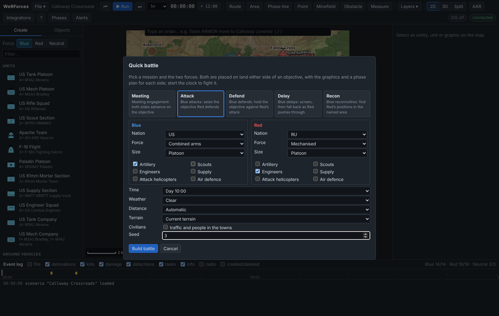
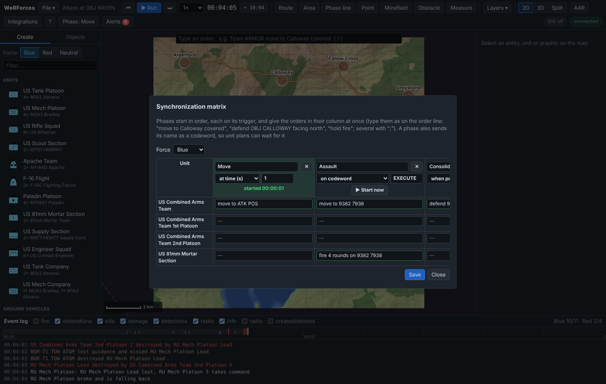
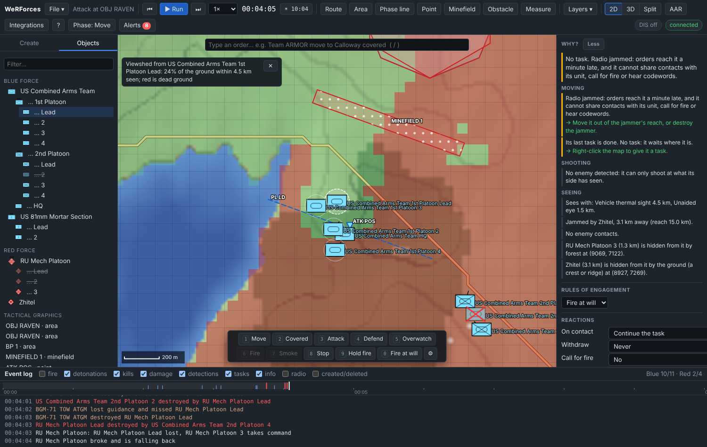

# Tutorial 16: Quick battle and command tools

**Time:** 30 minutes · **You will learn:** building a battle with the quick
battle wizard, the synchronization matrix and codewords, typed orders and the
quick-task bar, travel estimates, the *Why?* explanation, alerts, viewsheds,
radio jamming, and driving a vehicle yourself.

The scenario: a US combined arms team (an M1A2 tank platoon, an M2A3 Bradley
platoon and an HQ tank) with an 81 mm mortar section attacks a Russian BMP-2
platoon dug in on objective **RAVEN**, behind a minefield. Halfway through, a
Russian R-330Zh jammer comes up on the air.

Every output below is real. It comes from a fresh server (`npm start`) given
exactly these commands at these times, and the run is deterministic, so you
get the same numbers. Alert ids count from the server's start, so start a new
server for this tutorial. Each step shows the GUI and the REST call; the REST
calls use:

```bash
H='Content-Type: application/json'; B=localhost:8080/api/v1
```

## 1. Build a quick battle

Start the server, open <http://127.0.0.1:8080> and choose **File → Quick
battle…**. Make these choices:

| Field | Value |
| --- | --- |
| Mission | **Attack** (Blue attacks: seize the objective Red defends) |
| Blue | US · Combined arms · Platoon · tick only **Artillery** |
| Red | RU · Mechanised · Platoon · tick only **Engineers** |
| Time, Weather, Distance, Terrain | Day 10:00 · Clear · Automatic · Current terrain |
| Civilians | unticked |
| Seed | **3** |



Press **Build battle**. Over the API:

```bash
curl -s -H "$H" $B/scenario/quick-battle -d '{"mission": "attack", "seed": 3,
  "blue": {"composition": "combined", "support": ["artillery"]},
  "red": {"composition": "mech", "support": ["engineers"]}}'
```

```json
{"scenario": "Attack at OBJ RAVEN",
 "description": "Blue attacks: seize the objective Red defends. Blue (US Combined Arms Team with artillery) attacks from 3.0 km out to seize OBJ RAVEN. Red (RU Mech Platoon with engineers) defends it. Starts at 10:00, clear. Each side's plan is in its synchronization matrix (Phases). Seed 3.",
 "seed": 3, "entities": 14, "units": 5, "graphics": 6,
 "strength": [{"force": 1, "name": "Blue", "total": 11, "alive": 11}, {"force": 2, "name": "Red", "total": 3, "alive": 3}]}
```

The wizard replaced the scenario (it is one edit, so **Undo** brings the old
one back) and kept the terrain. The same seed and choices always give the same
battle; without a seed you get a random one, and the response tells you which.
`GET /scenario/quick-battle` lists every choice it takes.

## 2. Read the brief

The GUI shows the `description` as a brief, with **Start**, **Show phases** and
**Close**. Press **Close** for now. The **Objects** tab holds:

| Id | Unit | Members | Where |
| --- | --- | --- | --- |
| U1 | US Combined Arms Team | the HQ tank (E1) | 8.29E 4.92N |
| U2 | … 1st Platoon (under U1) | 4 M1A2 (E2–E5) | 8.21E 5.09N |
| U3 | … 2nd Platoon (under U1) | 4 M2A3 (E6–E9) | 8.56E 5.04N |
| U5 | US 81mm Mortar Section | 2 mortar teams (E13, E14) | 7.97E 3.98N |
| U4 | RU Mech Platoon | 3 BMP-2 (E10–E12) | 9.38E 7.94N |

Under *Tactical graphics* are the objective **OBJ RAVEN** (drawn once for each
side), Red's battle position **BP 1** and **MINEFIELD 1**, 600 m in front of
it, and Blue's attack position **ATK POS** (8.92E 6.67N) and line of departure
**PL LD**. The tree shortens names under their parent (*… 1st Platoon*); hover
for the full name.

## 3. The synchronization matrix

Press **Phases** in the toolbar (or **Show phases** in the brief). This is
Blue's operation, one column per phase and one row per unit. Over the API, `GET
$B/sync-matrix` returns both sides' matrices. In short:

| Force | Phase | Trigger | Orders |
| --- | --- | --- | --- |
| Blue | P1 Move | at time 1 s | US Combined Arms Team: move to ATK POS |
| Blue | P2 Assault | when previous done, +30 s | US Combined Arms Team: assault OBJ RAVEN; US 81mm Mortar Section: fire 4 rounds on OBJ RAVEN |
| Blue | P3 Consolidate | when previous done, +10 s | US Combined Arms Team: consolidate (defend) on OBJ RAVEN |
| Red | P1 Defend | at time 0 | RU Mech Platoon: defend BP 1 |

Phases start in order. When one starts, it gives all its orders at once and
sends its name to its force as a **codeword**: *Move* sends *MOVE*, so a unit's
plan can *wait until codeword MOVE*.

As planned, Blue assaults 30 s after the team reaches ATK POS. Make it wait for
your word instead: change P2's trigger to the codeword **EXECUTE**. A matrix is
replaced as a whole, and each order can be given in words, as you would type it
on the order line but without the unit's name:

```bash
curl -s -X PUT -H "$H" $B/sync-matrix/blue -d '{"phases": [
  {"id": "P1", "name": "Move", "trigger": {"type": "time", "time": 1},
   "orders": [{"targetId": "U1", "text": "move to ATK POS"}]},
  {"id": "P2", "name": "Assault", "trigger": {"type": "codeword", "codeword": "EXECUTE"},
   "orders": [{"targetId": "U1", "text": "move to 9382 7938"},
              {"targetId": "U5", "text": "fire 4 rounds on 9382 7938"}]},
  {"id": "P3", "name": "Consolidate", "trigger": {"type": "previousDone", "delay": 10},
   "orders": [{"targetId": "U1", "text": "defend 9382 7938 facing 20 width 500 m"}]}]}'
```

The server turns each `text` into a task (it answers 400, naming the unit and
phase, if it can't) and returns the matrix, with `started` still empty:

```json
{"force": 1, "phases": [{"id": "P1", "name": "Move", "trigger": {"type": "time", "time": 1}, ...},
  {"id": "P2", "name": "Assault", "trigger": {"type": "codeword", "codeword": "EXECUTE"}, ...},
  {"id": "P3", "name": "Consolidate", "trigger": {"type": "previousDone", "delay": 10}, ...}],
 "started": {}}
```

(9382 7938 is the centre of OBJ RAVEN. Exercise control sees both sides'
*OBJ RAVEN*, so the name alone is ambiguous; a player would only see their
own.) Open **Phases** again: the cells now read as typed, green when they parse
as an order. Each column's trigger is the chooser under its name: *by hand*,
*at time (s)*, *on codeword* or *when previous done (+s)*.



## 4. Typed orders

The team will drive to ATK POS across open ground. Send it by a covered route
instead. Press **⏭** five times, to 0:00:05, so phase *Move* has started (an
order given at 0:00 would be replaced by the phase's own order at 0:01). Press
**/** and type:

```
US Combined Arms Team move to ATK POS covered
```

As you type, the list under the line offers names, verbs and places (**Tab**
takes one); when the order is complete it shows how it reads: *↵ US Combined
Arms Team: move to ATK POS by a covered route*. **Enter** sends it. To check an
order without sending it, use `dryRun`:

```bash
curl -s -H "$H" $B/orders -d '{"text": "US Combined Arms Team move to ATK POS covered", "dryRun": true}'
```

```json
{"description": "US Combined Arms Team: move to ATK POS by a covered route", "targets": ["U1"],
 "commands": [{"cmd": "assignTask", "targetId": "U1", "task": {"type": "moveTo", "target": {"x": 8922, "y": 6668}, "covered": true}}],
 "executed": false}
```

Without `dryRun` the same call carries it out (`"executed": true`). Orders it
can't read get a 400 that says what is missing: *US Combined Arms Team defend*
answers *Defend: where? Give a town, a graphic, an object, "x y" or "2 km north
of …"*. Places can be relative: *US 81mm Mortar Section smoke 2 rounds on 600 m
south of BP 1* reads as a smoke mission on (9382, 7338).

The event log so far:

```
00:00:01 info       Move begins (scheduled)
00:00:01 task       US Combined Arms Team 1st Platoon: Move to (8839, 6836)
00:00:01 task       US Combined Arms Team 2nd Platoon: Move to (9196, 6792)
00:00:01 task       US Combined Arms Team: Move to (8922, 6668)
00:00:01 info       Blue codeword MOVE
00:00:01 info       Defend begins (scheduled)
00:00:01 task       RU Mech Platoon: Defend (9382, 7938) (moving)
00:00:01 info       Red codeword DEFEND
00:00:05 task       US Combined Arms Team 1st Platoon: Move to (8848, 6827) by a covered route
00:00:05 task       US Combined Arms Team 2nd Platoon: Move to (9199, 6772) by a covered route
00:00:05 task       US Combined Arms Team: Move to (8922, 6668) by a covered route
```

The team passed its order down to its platoons, each keeping its place.

**The quick-task bar.** With a unit selected, the bar at the bottom of the map
offers the common orders as buttons with keys **1**–**0**: *Move*, *Covered*,
*Attack*, *Defend*, *Overwatch*, *Fire*, *Smoke*, *Stop*, *Hold fire*, *Fire
at will*. Press **2** and click ATK POS for the same covered move. **⚙**
chooses the buttons.

## 5. Travel estimates

Select the team. Its **Current activity** ends in the travel estimate, and with
**Layers → Planned paths** on, the path on the map ends in *ETA 10:04*. Routes
are planned as soon as an order is given, so this shows even while paused. At
0:00:05:

```bash
curl -s $B/units/U1
```

```json
{"id": "U1", "name": "US Combined Arms Team", "task": "Move to (8922, 6668) by a covered route",
 "travel": {"remaining": 1983, "eta": 252.4, "etaLocal": "10:04"}, ...}
```

Set the time multiplier to 8× and run to 0:01:00 (or `POST $B/simulation/step`
with `{"seconds": 55}`). The team has 1378 m to go and still arrives at 252.4 s;
the inspector reads *1.4 km to go, ETA 10:04 local (in 3 min)*. The 1st
Platoon's own estimate is *1375 m, 238.4 s (10:03)*. The estimate takes the
ground along the path (roads, forest, slopes) into account, but not halts for
contact.

## 6. Why?

Still at 0:01:00, select the 1st Platoon's leader (*US Combined Arms Team 1st
Platoon Lead*, E2). The **Why?** section of the inspector says what it is doing
and what stops it; **Details** gives every reason:

```bash
curl -s $B/entities/E2/explain
```

```json
{"id": "E2", "name": "US Combined Arms Team 1st Platoon Lead", "kind": "entity",
 "activity": "Move to (8848, 6827) by a covered route",
 "summary": "Move to (8848, 6827) by a covered route.",
 "movement": [],
 "fire": [{"code": "noContacts", "severity": "info", "text": "No enemy detected: it can only shoot at what its side has seen."}],
 "sensing": [
  {"code": "sensors", "severity": "info", "text": "Sees with: Vehicle thermal sight 4.5 km, Unaided eye 1.5 km."},
  {"code": "contacts", "severity": "info", "text": "No enemy contacts."},
  {"code": "hidden", "severity": "info", "text": "RU Mech Platoon 2 (2.4 km) is hidden from it by the ground (a crest or ridge) at (9070, 7813).", "at": {"x": 9070, "y": 7813}, "aboutId": "E11"},
  {"code": "hidden", "severity": "info", "text": "RU Mech Platoon Lead (2.4 km) is hidden from it by forest at (8481, 6126).", "at": {"x": 8481, "y": 6126}, "aboutId": "E10"},
  {"code": "hidden", "severity": "info", "text": "RU Mech Platoon 3 (2.4 km) is hidden from it by forest at (8514, 6106).", "at": {"x": 8514, "y": 6106}, "aboutId": "E12"}]}
```

Nothing is in its way, and the covered route is doing its job: the BMPs are
within its thermal sight's 4.5 km, but a crest and a wood hide them. Click a
*hidden* line in **Details**: the map marks the spot with a red ✕, with the
sight line drawn to it. As exercise control you are told about enemies the
tank hasn't seen; a player is only told what their side knows. Red items in
the list block what the entity is doing (out of range, hold fire, pinned...),
amber ones hamper it, and most come with a fix (*→ Set ROE to "fire at will"*).

Run on to 0:04:00. The 2nd Platoon, east of the others, met the BMPs on its
way: one BMP is destroyed. The HQ tank's explanation (`GET $B/units/U1/explain`)
now has a `unit` part, *Commands US Combined Arms Team 1st Platoon, US Combined
Arms Team 2nd Platoon: its orders are passed down to them*, and its movement is
*Slowed by forest*: the covered route runs through the wood.

## 7. Alerts

The **Alerts** button shows how many alerts are open; click it for the list,
newest first:

```bash
curl -s $B/alerts
```

| Id | Time | Kind | Severity | Text |
| --- | --- | --- | --- | --- |
| A5 | 00:03:45 | losses | warning | RU Mech Platoon: RU Mech Platoon 2 destroyed (2 left) |
| A3 | 00:02:13 | underFire | info | US Combined Arms Team 2nd Platoon is under fire |
| A4 | 00:02:13 | contact | info | RU Mech Platoon has made contact with the enemy |
| A1 | 00:02:05 | contact | info | US Combined Arms Team 2nd Platoon has made contact with the enemy |
| A2 | 00:02:05 | underFire | info | RU Mech Platoon is under fire |

Click one to select and centre its unit, or press **N** to step through them.
✓ acknowledges one; **Acknowledge all** clears the list:

```bash
curl -s -X POST -H "$H" $B/alerts/acknowledge
```

```json
[]
```

Alerts are raised for units idle after their orders, broken, out of fuel or
ammunition, leader lost, losses, failed tasks, first fire and first contact,
and jammed radios. Critical ones (broken, out of fuel or ammunition) also pop
up.

## 8. Viewshed

Where can the team see from once it is at ATK POS? Right-click ATK POS and
choose **What can be seen from here (viewshed)**:

```bash
curl -s -H "$H" $B/terrain/viewshed -d '{"from": {"x": 8922, "y": 6668}, "radius": 3000}'
```

```json
{"x0": 5922, "y0": 3668, "cell": 50, "cols": 121, "rows": 121,
 "eye": {"x": 8922, "y": 6668, "z": 24.75}, "radius": 3000, "targetHeight": 2,
 "visibleFraction": 0.161, "cellsB64": "..."}
```

Only 16 % of the ground within 3 km can be seen from a point 2 m above ATK POS:
the wood and the crest south of the objective hide most of it, which is why it
is a good attack position. For an entity, the radius is its best sensor's range
now. Select E2 and press **Viewshed** in the inspector: *24% of the ground
within 4.5 km seen; red is dead ground* (`"from": "E2"` gives
`"visibleFraction": 0.237`, `"radius": 4500`, on 60 m cells). ✕ on the chip
clears it.



## 9. A jammer

At 0:04:00 a Russian R-330Zh Zhitel radio jammer comes up 2 km behind the
objective. Click **Red** in the Create tab, type *Zhitel* in **Filter…**, click
**R-330Zh Zhitel jammer** and place it at **9.400E 9.900N**. Click its name in
the inspector and rename it *Zhitel*. Over the API:

```bash
curl -s -H "$H" $B/entities -d '{"typeId": "ru-r330zh", "force": 2, "position": {"x": 9400, "y": 9900}, "name": "Zhitel"}'
```

```json
{"id": "E15", "name": "Zhitel", "typeId": "ru-r330zh", "jamming": true, ...}
```

Jammers start switched on. Its 15 km reach (the purple dashed circle on the
map) covers the whole Blue force. Run to 0:04:05:

```
00:04:00 created    Zhitel created
00:04:01 info       US Combined Arms Team: radio jammed
00:04:01 info       US Combined Arms Team 1st Platoon: radio jammed
00:04:01 info       US Combined Arms Team 2nd Platoon: radio jammed
00:04:01 info       US 81mm Mortar Section: radio jammed
00:04:01 destroyed  US Combined Arms Team 2nd Platoon 2 destroyed by RU Mech Platoon Lead
00:04:03 destroyed  RU Mech Platoon Lead destroyed by US Combined Arms Team 2nd Platoon 4
00:04:03 info       RU Mech Platoon: RU Mech Platoon Lead lost, RU Mech Platoon 3 takes command
00:04:04 info       RU Mech Platoon broke and is falling back
```

Every Blue unit's activity now shows *RADIO JAMMED* (`"jammed": ["radio"]` on
its entities), and four new alerts read *radio jammed* (A6–A9, severity
warning). E2's **Why?** explains what that means:

- *Radio jammed: orders reach it a minute late, and it cannot share contacts
  with its unit, call for fire or hear codewords. → Move it out of the jammer's
  reach, or destroy the jammer.* (warn)
- *Jammed by Zhitel, 3.1 km away (reach 15.0 km).* (info, exercise control
  only)

Now give the word for the assault. There is no codeword button in the GUI:
send it over the API (or MCP `send_codeword`), or press **▶ Start now** on the
Assault column in **Phases**, which starts the phase the same way. At 0:05:00:

```bash
curl -s -H "$H" $B/codewords -d '{"force": 1, "codeword": "execute"}'
```

```json
{"force": 1, "codeword": "EXECUTE", "time": 300}
```

Codewords are upper-cased. The phase starts within a second, but its orders go
out over jammed radios:

```
00:05:00 info       Blue codeword EXECUTE
00:05:01 info       Assault begins (codeword EXECUTE)
00:05:01 task       Order to US Combined Arms Team: Move to (9382, 7938) (arrives in 60 s, radio jammed)
00:05:01 task       Order to US 81mm Mortar Section: Fire mission at (9382, 7938), 4 rounds (arrives in 60 s, radio jammed)
00:05:01 info       Blue codeword ASSAULT
00:06:01 task       Order to US Combined Arms Team 1st Platoon: Move to (9286, 8002) (arrives in 60 s, radio jammed)
00:06:01 task       Order to US Combined Arms Team 2nd Platoon: Move to (9737, 7728) (arrives in 60 s, radio jammed)
00:06:01 task       US Combined Arms Team: Move to (9382, 7938)
00:06:01 task       US 81mm Mortar Section: Fire mission at (9382, 7938), 4 rounds
```

Each level of the chain of command loses a minute: the team got the order at
6:01 and passed it down, and the jammed platoons will only get it at 7:01. `GET
$B/codewords` lists *MOVE* and *DEFEND* (0:00:01), *EXECUTE* (300) and
*ASSAULT* (301), and `GET $B/sync-matrix` shows `"started": {"P1": 1, "P2":
301}` and `"current": "P2"`. From 6:21 each mortar fires its four rounds on the
objective, and at 6:47 the section raises an *idle* alert: it has finished its
orders.

At 0:07:00 switch the jammer off: select it and press **Switch off** in its
**Jamming** section, or

```bash
curl -s -X PATCH -H "$H" $B/entities/E15 -d '{"jamming": false}'
```

```json
{"id": "E15", "name": "Zhitel", "jamming": false, ...}
```

```
00:07:00 info       Zhitel: jamming off
00:07:00 info       US Combined Arms Team: radio back
00:07:00 info       US Combined Arms Team 1st Platoon: radio back
00:07:00 info       US Combined Arms Team 2nd Platoon: radio back
00:07:00 info       US 81mm Mortar Section: radio back
```

The *radio jammed* alerts close by themselves. The platoons' orders, already on
their way, arrive at 7:01. (With jamming off, a new order would arrive at once.)

## 10. The assault

Run on to 0:15:00. With **detections**, **detonations** and **radio** unticked:

```
00:07:01 task       US Combined Arms Team 1st Platoon: Move to (9286, 8002)
00:07:01 task       US Combined Arms Team 2nd Platoon: Move to (9737, 7728)
00:07:53 damaged    RU Mech Platoon 3 suffered a mobility kill
00:07:53 info       US Combined Arms Team HQ fired smoke grenades
00:07:59 destroyed  RU Mech Platoon 3 destroyed by US Combined Arms Team HQ
00:08:24 damaged    Zhitel suffered a firepower kill
00:08:28 damaged    US Combined Arms Team 1st Platoon 2 suffered a mobility kill
00:08:28 destroyed  US Combined Arms Team 1st Platoon 2 destroyed by a mine in MINEFIELD 1
00:08:45 destroyed  Zhitel destroyed by US Combined Arms Team 2nd Platoon Lead
00:09:36 info       Consolidate begins (Assault complete)
00:09:36 task       US Combined Arms Team 1st Platoon: Defend (9265, 7981) (moving)
00:09:36 task       US Combined Arms Team 2nd Platoon: Defend (9499, 7895) (moving)
00:09:36 task       US Combined Arms Team: Defend (9382, 7938) (moving)
00:09:36 info       Blue codeword CONSOLIDATE
```

The Red platoon had rallied at 4:32, but its last BMP is knocked out by the HQ
tank as the team closes in, and the jammer, now a known contact, soon after. A
tank of the 1st Platoon runs onto the minefield. The assault complete, phase
*Consolidate* starts 10 s later. The count is **Blue 9/11 · Red 0/4**. The
**Phases** button reads *Phase: Consolidate*.

## 11. Drive a vehicle

Take the HQ tank yourself. Select *US Combined Arms Team HQ* (E1) and press
**G** (or **Drive** in the inspector). The map follows it and a panel shows its
speed, heading, throttle and target. **W** opens the throttle by a quarter
each press, **S** closes it, **A**/**D** turn while held, **X** stops, **T**
then a click on an enemy picks a target it engages first whatever its ROE,
**C** clears it, and **Esc** hands it back.

Over the API, at 0:15:00, half throttle:

```bash
curl -s -H "$H" $B/entities/E1/drive -d '{"throttle": 0.5}'
```

```json
{"id": "E1", "name": "US Combined Arms Team HQ", "task": "Direct control, 50% throttle", "speed": 0, "headingDeg": 20, ...}
```

The log says *US Combined Arms Team HQ: under direct control*. Twenty seconds
later it is doing 9 m/s (half an M1A2's top speed) on heading 20°. A turn
lasts 1.5 s unless it is sent again (the GUI repeats it while the key is held):

```bash
curl -s -H "$H" $B/entities/E1/drive -d '{"turn": -1}'
```

Two seconds later it has swung to heading 328° and slowed to 6.6 m/s for the
turn. Driving the team's leader took the team's own orders away: its task is
now empty. `{"targetId": "E12"}` would pick a target, `{"targetId": null}`
clears it. Any other order, such as **Stop**, ends direct control:

```bash
curl -s -X POST -H "$H" $B/entities/E1/stop
```

## 12. The same from an AI agent

Every step has an MCP tool ([reference](../reference/mcp-tools.md)):

| Step | MCP tool |
| --- | --- |
| Quick battle | `quick_battle` (returns the brief) |
| Synchronization matrix | `set_sync_matrix`, `start_phase` |
| Codewords | `send_codeword` |
| Typed orders | `give_order` (with `dryRun`) |
| Why? | `explain` |
| Alerts | `get_alerts` (with `acknowledge`) |
| Viewshed | `viewshed` |
| Jammers | `set_jamming` |

*"Build an attack quick battle with seed 3, then tell me why the 1st Platoon
can't see the enemy"* is enough for an agent connected as in [Tutorial
5](05-ai-agents-with-mcp.md).

## What you learned

- The **quick battle** wizard builds a ready-to-run battle from a mission, two
  forces, support, time and weather, with the same battle for the same seed.
- A **synchronization matrix** runs a force's operation in phases, started by
  time, codeword, the previous phase or by hand; each phase announces itself
  with a **codeword**.
- **Typed orders** and the **quick-task bar** give orders without hunting
  through menus, and **travel estimates** say when moves will end.
- **Why?** explains what stops a unit, and **alerts** say which units need you.
- A **viewshed** shows what can be seen from a place, and its dead ground.
- **Radio jamming** delays orders a minute at each level of command and cuts
  contact sharing, calls for fire and codewords.
- **Direct control** lets you drive a vehicle and pick its target.

See also [Concepts → Synchronization matrix](../concepts.md#synchronization-matrix),
[Electronic warfare](../concepts.md#electronic-warfare),
[Explanations and alerts](../concepts.md#explanations-and-alerts), and the
[User guide](../user-guide.md#typed-orders).
