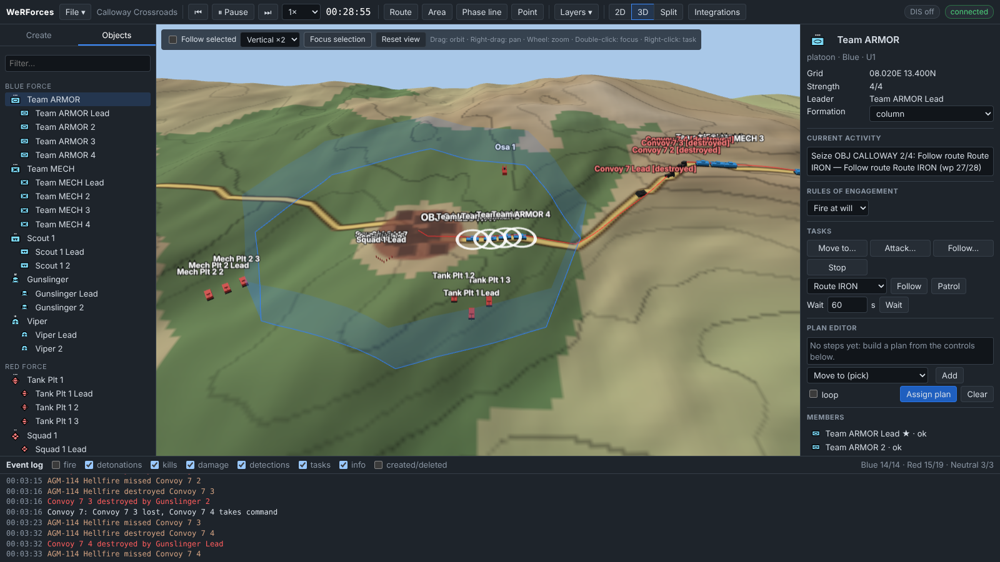

# User guide

The WeRForces window has five areas:

```
┌───────────────────────────── toolbar ──────────────────────────────┐
│ left panel   │            map (2D, 3D or split)        │ inspector │
│ Create /     │                                         │           │
│ Objects      │                                         │           │
├──────────────┴──────────── event log ─────────────────────────────┤
```

## Toolbar

| Control | What it does |
| --- | --- |
| **File ▾** | **Undo** / **Redo** (Ctrl+Z / Ctrl+Y), **New scenario** (on generated terrain, or an imported real terrain), **Quick battle…** (a ready-to-run battle; see [below](#quick-battle)), **Open scenario…** (from the server's `scenarios/` folder), **Import from file…**, **Export to file** (downloads the current state as JSON), **Save on server…**, **Review saved recording…**, **Batch analysis…** (see [below](#batch-analysis)), **Sessions…** (see [below](#sessions)), **Catalog editor…** (see [below](#catalog-editor)), **Simulation settings…** (optional models, time of day and weather, civilians) |
| Scenario name | The loaded scenario; a *session* pill when this page belongs to a session other than the main one |
| ⏮ | **Rewind**: reload the scenario as it was when last loaded. Anything since is discarded |
| ▶ Run / ⏸ Pause | Start or stop the clock (**Space**) |
| ⏭ | Advance one second while paused |
| 0.5× … 32× | Time multiplier: how many simulated seconds pass per real second |
| 00:00:00 | Simulation time since the scenario started. It turns amber when the server cannot keep up with the time multiplier (hover for its load) |
| ☀ 12:00 | Local time of day and weather (☾ night, ◐ twilight, ≋ fog or haze, ☂ rain, ❄ snow); click to change them |
| **Route / Area / Phase line / Point / Minefield / Obstacle** | Drawing tools for tactical graphics (see below) |
| **Measure** | Distances and bearings between clicked points; with two points, line of sight (**M**) |
| **Layers ▾** | Labels, grid, sensor contacts, weapon/sensor range rings, planned paths, unit display (auto / aggregate / entities), and symbol style (MIL-STD-2525 or simple) |
| **2D / 3D / Split** | Which map views are shown |
| **AAR** | After-action review: replay the recording (see [below](#after-action-review)) |
| **Integrations** | API and MCP connection details, TAK output, webhooks, GIS feeds |
| **?** | This documentation |
| **Phases** | The [synchronization matrix](#synchronization-matrix). The button shows the phase in progress (*Phase: Assault*), or *Phases (not started)* |
| **Alerts** | The [attention queue](#alerts), with the number of open alerts (red when one is critical) |
| Role pill | *Blue player · fog of war* when you joined with a player key (see [below](#playing-one-force-fog-of-war)) |
| DIS pill | DIS status when started with `--dis`: exercise, site:application, PDUs sent and received, remote entities |
| connected | WebSocket connection to the simulation server |
| *Name · sign out* | Who is signed in, when the server uses OpenID Connect sign-in |

## Left panel

### Create

1. Choose the **force**: Blue, Red or Neutral. Graphics you draw also take this
   force's colour.
2. Pick an item. **Units** are whole formations (e.g. *US Tank Platoon*, four
   M1A2s in a wedge). The other groups are single entities: ground vehicles,
   dismounted, aircraft and surface vessels. Typing in **Filter…** searches
   every force's catalog.
3. Click the map to place it. **Shift+click** places several. **Esc** stops.

Ground vehicles and people cannot be placed in water, and boats cannot be placed
on land. If a unit's formation slot lands in a lake, that member is moved to the
nearest valid spot.

### Objects

A tree of every object, grouped by force: units with their subordinate units
(a company's platoons) and members, single entities, entities received over DIS
(marked *remote*), and tactical graphics. Click to select. Double-click to
centre the map. Destroyed entities are struck through. A name that repeats its
parent's is shortened (*… 1st Platoon* under *US Mech Company*); hover for the
full name.

## 2D map

| Action | How |
| --- | --- |
| Select | Left-click a symbol, route or area |
| Select several | **Shift+click** adds or removes; **Shift+drag** a box around them |
| Context menu (tasking) | Right-click (see below) |
| Pan | Drag empty map, or middle-drag |
| Zoom | Mouse wheel (zooms around the cursor) |
| Move an entity | **Alt+drag** it |
| Centre on selection | **F** |
| Delete selection | **Delete** |

Symbols are MIL-STD-2525C (drawn with [milsymbol](https://github.com/spatialillusions/milsymbol));
**Layers ▾ → Symbols: simple** switches to a lighter style. Each entity type has
a symbol code (SIDC) in the [catalog](reference/catalog.md); the frame comes from
the force and the dimension, and the echelon amplifier from the unit.

- **Frame shape and colour show the force.** Blue rectangle = friendly, red
  diamond = hostile, green square = neutral, yellow = other. Aircraft use the
  open-bottomed "air" frame and ships a circle.
- **The icon inside shows the role:** armour, mechanised, infantry, recon,
  cavalry, air defence, field artillery, mortar, engineer, supply, transport,
  attack or utility helicopter, fighter, UAV, ship or boat.
- **Other markings:**
  - a line from the symbol shows heading and speed;
  - an orange bar under the symbol means a mobility or firepower kill;
  - a red ✕ means destroyed;
  - a dashed yellow outline means the entity is remote (owned by another DIS
    simulation);
  - a red halo shows how hard the entity is being suppressed (thicker when
    pinned down);
  - background civilians ([pattern of life](#simulation-settings)) are drawn
    smaller and fainter, without labels unless selected.

When zoomed out (or with *Units: aggregate*), each unit is drawn as one symbol
at its leader, with its echelon above (••• platoon, •• section, Ø team) and its
strength in the label, e.g. *(3/4)*. Zoom in to see the individual vehicles.

Effects: shots appear as yellow tracer lines from shooter to target. Detonations
appear as an orange flash for a hit and a grey puff for a miss. Smoke clouds are
grey discs that drift with the wind. At night and in twilight the map darkens.
A jammer that is switched on has its reach drawn as a faint purple dashed
circle. With **Layers → Planned paths**, the selection's path ends in its
arrival time (*ETA 10:04*).

Over the map:

- the **order line** at the top (see [Typed orders](#typed-orders));
- the **quick-task bar** at the bottom, when something is selected (see
  [Quick-task bar](#quick-task-bar));
- a chip with the [viewshed](#viewshed) on show, and the panel of a vehicle you
  [drive](#drive-mode).

Imported terrain can show land cover (built-up grey, wetland, shrub, bare,
snow) and, when zoomed in, building footprints.

The readout in the bottom-right corner shows the cursor position as grid
(km east/north), latitude/longitude, elevation, and whether the ground is open,
forest or water.

### Context menu

What appears depends on what is selected and what you right-click:

| Selection | Right-click on | Menu items |
| --- | --- | --- |
| Entity or unit | Empty map | **Move here**, **Move here by a covered route**, **Overwatch here**, **Defend here**, **Screen here**, **Orbit here (2 km)** (aircraft), **Fire mission here (3 rounds)** and **Smoke screen here (2 rounds)** (artillery and mortars), **Move here and dismount** (carriers with passengers), **Add "move here" to plan**, **Stop** |
| Entity or unit | An area | **Search *area***, **Ambush *area* from here**, plus the empty-map items |
| Engineers | A minefield or obstacle | **Breach a lane through *name***, **Move here** |
| Entity or unit | A hostile entity or unit | **Attack *name***, **Fire mission on *name*** (artillery and mortars), **Follow *name***, **Stop** |
| Entity or unit | A friendly supply vehicle | **Resupply from *name***, **Follow *name***, **Stop** |
| Several things (Shift+click) | Empty map | **Move here (keep formation)**, **Move here by a covered route**, **Defend here (in line)**, **Overwatch here (in line)**, **Fire mission here** (those with guns), **Stop all** |
| Several things | A hostile | **All attack *name*** |
| Several units | A friendly unit | **Put under *name*** (chain of command) |
| Infantry | A friendly carrier (or carrier unit) | **Mount *name*** (walk over and board), **Put inside *name* now** (scenario set-up), **Follow *name***, **Stop** |
| Entity or unit | A route or phase line | **Follow route *name***, **Patrol route *name***, **Stop** |
| Anything | Any object | **Select**, **Center map**, **Delete** |
| Anything | Anywhere | **Center map here**, **Place point here**, **What can be seen from here (viewshed)**, **Clear viewshed** (when one is shown), **Place armed item here** (when a palette item is armed) |

## 3D view



Click **3D** (or **Split** for 2D and 3D side by side). The 3D view shows:

- shaded terrain with roads and towns;
- vehicle, aircraft and ship models in force colours (dark when destroyed);
  passengers are not drawn while they ride;
- routes and phase lines draped over the ground;
- objective areas, minefields and obstacles drawn as translucent curtains, and
  breached lanes as white lines;
- extruded buildings on imported terrain;
- smoke clouds, and a darker sky and closer haze at night or in poor visibility;
- tracers and detonations.

| Action | How |
| --- | --- |
| Orbit | Drag |
| Pan | Right-drag |
| Zoom | Wheel (towards the cursor) |
| Select | Click a model |
| Fly to a model | Double-click it, or **Focus selection** |
| Context menu | Right-click (same items as 2D; the ground point under the cursor is used) |
| Track the selection | **Follow selected** |
| Terrain exaggeration | **Vertical ×1/×2/×3/×5** (default ×2 so hills read clearly) |
| Back to the overview | **Reset view** |

Models grow with distance so they stay visible from far away. They are only to
scale up close. The 3D code is downloaded the first time you open the view.

## Inspector (right panel)

### Entity

- **Name.** Click it to rename.
- **Grid, Lat/Lon, Altitude** (aircraft also show height above ground),
  **Heading, Speed, Damage**, **Suppression** (a bar), **Morale** (entities not
  in a unit), **Fuel** (a gauge), **Supplies** (supply vehicles: vehicle loads
  left), and the **Unit** it belongs to (click to select the unit).
- **Current activity**: the running plan step and task, e.g. *Seize OBJ 2/4:
  Follow route IRON — Follow route IRON (wp 3/28)*. It also shows *PINNED*,
  *BROKEN*, *DUG IN* / *HULL-DOWN*, *HALTED (contact)*, *ORDER IN n s* (an
  order still on its way, with the order-delay rule), *RADIO JAMMED*, *RADAR
  JAMMED*, *JAMMING* (a jammer that is on) and, while it moves along a planned
  path, the travel estimate: *1.4 km to go, ETA 10:04 local (in 3 min)*, or
  *stalled: out of fuel*.
- **Why?**: one line on what it is doing and the main thing in its way.
  **Details** lists every reason under *Moving*, *Shooting* and *Seeing*
  (units also *Unit*), each with what you can do about it. Red items block the
  activity, amber ones hamper it, grey ones explain it. Click an item with a
  place, e.g. *No line of sight to T-72B3: blocked by the ground (a crest or
  ridge) at (9070, 7813)*, to mark the spot and the sight line on the map for
  8 s; click one about another entity to select it. The section refreshes every
  2 s. Exercise control is also told which enemies the entity has not
  detected, and why. See [Concepts](concepts.md#explanations-and-alerts).
- **Rules of engagement**: Fire at will, Return fire or Hold fire (see
  [Concepts](concepts.md#rules-of-engagement)).
- **Reactions** (see [Concepts](concepts.md#reactions)):
  - **On contact**: *Continue the task* or *Halt and fight*;
  - **Withdraw**: *Never*, or *When weapons are knocked out* (entities) /
    *Below 75 %, 50 % or 25 % strength* (units), back to where it is now;
  - **Call for fire**: request fire missions on hostiles it sees.
- **Tasks:**
  - **Move to…**, **Attack…**, **Follow…** and **Orbit…** (aircraft) ask you to
    click a point or target;
  - **Stop**;
  - a route picker with **Follow** and **Patrol**;
  - **Wait** *n* seconds;
  - **Fire** *n* **rounds** → **Fire mission…** (artillery and mortars; click the
    target location);
  - **Mount…** (infantry; click the carrier), or **Passengers n/seats** with
    **Dismount** (carriers).

  A task replaces whatever the entity was doing, including its plan.
- **Plan editor**: see below.
- **Weapons**: rounds left out of the basic load, with maximum range.
- **Sensors**: what the entity can see with.
- **Contacts**: what it currently detects, with distance. ◎ marks its current
  target.
- **Jamming** (jammers only): what it jams and how far, and **Switch on** /
  **Switch off**.
- **Center**, **Viewshed** (see [below](#viewshed)), **Drive** (see
  [below](#drive-mode)) and **Delete**.

A passenger's activity reads *MOUNTED in …*.

### Unit

The same as an entity (with its own **Why?** and travel estimate), plus **Strength** (alive/total), **Morale**,
**Leader**, a **Formation** picker (column, line, wedge, vee, echelonRight), a
**Superior** picker (chain of command), **Subordinates**, and a **Members** list
(★ = leader).

Tasks given to a unit are carried out by the leader; the other members keep
formation on it. *Attack*, *Fire mission*, *Mount*, *Dismount* and *Resupply*
are the exceptions: every member does them. *Overwatch*, *Defend*, *Screen* and
*Ambush* deploy the members in a line across the facing. A mounted unit's
activity starts with *MOUNTED n/m*.

A unit with subordinates (a company) passes orders down: a move keeps the
platoons' positions relative to each other, *Defend*/*Overwatch*/*Screen*/
*Ambush* spread them in a line with the HQ behind, and other tasks go to all.
A plan step lasts until the subordinates have finished too.

### Several selected

Shift+click or Shift+drag selects several units or entities. The inspector lists
them, with **Group into a unit** (entities not in a unit), **Stop all**, **Clear
selection** and **Delete all**. Right-click the map to order them all.

### Graphic

Shows the kind, number of points and length or area, with Center and Delete.
Minefields also have a **Density** (chance of a mine strike per 100 m driven
through it), and minefields and obstacles list their breached **Lanes** and who
knows about them.

## Plan editor

A plan is a list of steps carried out in order. Build one in the inspector:

1. Optionally give the plan a **Name**. It appears in *Current activity* and in
   the event log.
2. Choose a step type, fill in its value, and press **Add**. Steps that need a
   location or target (*Move to*, *Attack*, *Orbit*, *Defend*...) then ask you
   to click the map.
3. Use **↑** to reorder and **✕** to remove a step (✕ on an *If* or *While*
   removes the block and its steps).
4. Tick **loop** to repeat the plan forever.
5. Press **Assign plan**.

Step types, grouped as in the chooser:

| Group | Steps |
| --- | --- |
| Movement | Move to (pick), Move by a covered route (pick), Follow route, Patrol route, Orbit (pick; radius m), Wait (seconds) |
| Tactics | Attack (pick), Overwatch, Defend and Screen (pick; facing °), Ambush area (pick position), Search area, Breach minefield or obstacle, Fire mission and Smoke (pick; rounds), Resupply at the nearest supply vehicle, Mount carrier (pick), Dismount passengers |
| Settings | Set ROE, Set speed (km/h), Set altitude (m above ground; 0 lands a helicopter), Set formation (units), Set reaction on contact, Set call for fire |
| Control | Wait until…, If… (block), Repeat while… (block), Else (in the current If), End block, Send codeword, Report on the radio |

Only the steps the selection can carry out are offered (no *Orbit* for a tank).
*Wait until*, *If* and *Repeat while* take a condition: enemy detected, under
fire, time is (s), in area, enemy in area, entity destroyed (pick), strength
below (%), fuel below (%), ammunition below (%), codeword received, or codeword
not yet received.

**Blocks.** *If…* and *Repeat while…* open a block: the steps you add next go
inside it, indented, and the line *▸ next step goes here* shows where. **Else**
starts the other branch of the current *If*. **End block** closes it, so the
next steps go after it. Double-click an *If* or *While* line to add steps
inside it again. Blocks can be nested. For example:

```
1. Move to 12.240E 06.600N
2. If enemy detected
3.   Set ROE: Hold fire
   Else
4.   Send codeword BRAVO
   End if
5. While no codeword EXECUTE yet
6.   Wait 30 s
   End while
7. Report "crossing PL LD"
```

**Codewords** coordinate plans: *Send codeword* tells the plan's own force a
word (*BRAVO*), and *Wait until codeword received* holds a plan until its force
has it. Exercise control or a player can send one too (REST `POST
/api/v1/codewords`), and every phase of a [synchronization
matrix](#synchronization-matrix) sends its name when it starts. A unit whose
radio is jammed does not hear codewords until its radio is back. **Report on
the radio** puts a message from the unit in the event log (*radio*).

Steps waiting for a time appear on the [timeline](#timeline) as yellow diamonds.

The draft stays in the editor after you assign it, so you can change it and
assign it again. **Clear** empties it. Right-clicking the map also offers **Add
"move here" to plan**. See [Tutorial 2](tutorials/02-routes-plans-and-conditions.md)
and [Concepts → Plans](concepts.md#plans).

## Drawing tactical graphics

Choose **Route**, **Area**, **Phase line**, **Point**, **Minefield** or
**Obstacle** in the toolbar, then:

- **click** to add points;
- **double-click**, **Enter** or **right-click** to finish;
- **Backspace** removes the last point and **Esc** cancels.

| Graphic | Used for |
| --- | --- |
| Route | *Follow route* and *Patrol* tasks (a route that ends where it starts is patrolled as a loop; otherwise it is ridden back and forth) |
| Area | *Wait until in area* conditions; objectives |
| Phase line | Reference line; can also be followed like a route |
| Point | Reference point (e.g. a staging point) |
| Minefield | Damages what crosses it (by density); a force that strikes a mine, or laid it, routes round it. Engineers breach 30 m lanes |
| Obstacle | A ditch or wire line: vehicles stop at it and route round it, infantry climb through slowly. Engineers breach lanes |

## Measuring

**Measure** (or **M**) and click points: each leg shows its distance and bearing,
the last point its elevation, and three or more points a total. With exactly two
points the tool asks the server for line of sight between eyes 2 m above the
ground: the line turns green (clear) or red (blocked). **Backspace** removes a
point, **Esc** or right-click ends.

## Undo and redo

**Ctrl+Z** (or File → **Undo**) takes back the last edit: placing, deleting,
moving, renaming, orders, plans, settings, loading a scenario. **Ctrl+Y** or
**Ctrl+Shift+Z** redoes it. The last 30 edits can be undone; running and pausing
are not edits. Undoing an order given mid-run goes back to the moment before it
(the clock too). The event log is kept. An order to several things at once (a
group order from the context menu or the quick-task bar, a typed order to
several units, **Delete all**) is one edit, undone in one step.

## Typed orders

The order line at the top of the map takes orders in words. Press **/** (or
click it) and type *who*, *what* and *where*:

```
Team ARMOR move to Calloway covered
Scout 1 screen 2 km north of Brenham facing north
Team ARMOR and Team MECH defend OBJ CALLOWAY facing northwest
Paladin Platoon fire 4 rounds on 9800 12300
Team MECH hold fire
```

- **Who**: names of your units or entities (the start of a name is enough when
  it is unique), joined with *and* or commas. Put a name in quotes if it
  contains *and*. With something selected, start with the verb instead
  (*defend Brenham facing north*): the order goes to the selection.
- **Verbs**: *move to* (add *covered*, *fast*, *slowly* or *at 30 km/h*),
  *attack*, *follow*, *defend* / *overwatch* / *screen* *place* (add *facing
  north* and *width 800 m*), *ambush area* (*from place*), *search area*,
  *patrol route*, *follow route route* (*in reverse*), *fire* (*N rounds*) *on
  place*, *smoke place*, *orbit place* (*radius 3 km*), *mount carrier*,
  *dismount*, *resupply* (*from X*), *breach minefield*, *wait 2 min*, *stop*,
  *hold fire*, *return fire*, *fire at will*.
- **Places**: a town, a graphic, an object, coordinates *9800 12300*, or *2 km
  north of Brenham*.

As you type, a list offers the next words: names, verbs, places. **Tab** or a
click takes the highlighted one, **↑**/**↓** move through the list (or through
the orders you sent, when the line is empty). When the order is complete, the
list shows how it was understood (*↵ Team ARMOR: move to Calloway by a covered
route*) or what is wrong with it. **Enter** sends it, and **Esc** leaves the
line. Several movers keep their spacing around the destination; several
defenders spread side by side across the facing.

Over the API it is `POST /api/v1/orders` with `{"text": "...", "dryRun": true}`
to check an order without carrying it out; over MCP, `give_order`.

## Quick-task bar

With units or entities selected, a bar at the bottom of the map gives one-click
orders. Each button has a key, **1** to **9** then **0**:

| Default buttons | What they do |
| --- | --- |
| **Move**, **Covered** | Click the destination (a covered route keeps out of known enemies' sight) |
| **Attack** | Click the enemy |
| **Defend**, **Overwatch** | Click the position; the facing is the direction from the selection. Several units spread in a line |
| **Fire**, **Smoke** | Click the target point: 3 rounds of HE, or 2 of smoke (guns and mortars only) |
| **Stop**, **Hold fire**, **Fire at will** | At once |

Buttons the selection can't use are greyed out. **⚙** chooses up to ten
buttons and their order from the full list (which adds *Follow*, *Screen*,
*Orbit*, *Return fire*, *Resupply* and *Dismount*). The choice is kept in this
browser.

## Alerts

**Alerts** in the toolbar is the attention queue: what needs looking at, newest
first, so you don't have to watch every unit. Each alert is about a unit or a
loose entity:

| Alert | Raised when | Severity |
| --- | --- | --- |
| idle | it has finished its orders and has had nothing to do for 10 s | info |
| task failed | a task failed (e.g. no route) | warning |
| broken | its morale broke | critical |
| out of fuel / low fuel | a member is out of fuel / below 20 % | critical / warning |
| out of ammunition | a member has fired off everything | critical |
| leader lost | the leader was destroyed or immobilised and another took over | warning |
| losses | a member was destroyed (counted: *×3*) | warning |
| under fire, contact | first fire or first enemy contact after a quiet minute | info |
| jammed | its radio is jammed | warning |

Critical alerts also pop up once. Click an alert to select and centre what it
is about, ✓ to acknowledge it, or **Acknowledge all**. **N** jumps to the next
alert. Alerts about a condition that clears (fuel, morale, jamming) close by
themselves. Players only see their own force's alerts. REST `GET
/api/v1/alerts`, MCP `get_alerts`.

## Synchronization matrix

**Phases** in the toolbar opens a force's operation as a table: one column per
phase, one row per unit (and loose entity), and in each cell that unit's order
for the phase, in words as on the [order line](#typed-orders) but without the
name (*move to Calloway covered*, *defend OBJ CALLOWAY facing north*, *hold
fire*; several separated by *;*). A cell turns green when it reads as an order
(hover to see how) and red when it doesn't.

Above each column are the phase's name and its trigger:

| Trigger | The phase starts |
| --- | --- |
| *by hand* | when you press **▶ Start now** (or `POST /api/v1/sync-matrix/{force}/phases/{id}/start`) |
| *at time (s)* | at that simulation time |
| *on codeword* | when the force receives the codeword |
| *when previous done (+s)* | when every order of the previous phase has been carried out, plus a delay |
| *on a condition* | when a plan condition holds for a unit (set through the API) |

Phases start in order: one waits until the one before it has started. When a
phase starts it gives all its orders at once and sends its name to the force as
a codeword (phase *Assault* sends *ASSAULT*), so unit plans can wait for it.
**+ Phase** adds a column, ✕ removes one, **Save** stores the matrix and
**Close** leaves without saving. A started phase shows *started 00:05:01*.
Exercise control picks the force at the top; a player plans for their own.
See [Concepts](concepts.md#synchronization-matrix).

## Viewshed

**Viewshed** in an entity's inspector shades the ground around it: clear where
it can see, red for dead ground (cells hidden by the ground, forest, buildings
or smoke), out to the range of its best sensor now (light and weather count; at
least 1 km, at most 10 km). Right-click the map and choose **What can be seen
from here** for the view from a point, 2 m above the ground, out to 3 km. The
chip at the top of the map gives the share of the ground seen, e.g. *24% of
the ground within 4.5 km seen*; ✕ (or **Clear viewshed** in the context menu)
removes it. Each cell is tested with the simulation's own line of sight, for a
target 2 m tall. REST `POST /api/v1/terrain/viewshed`, MCP `viewshed`.

## Drive mode

Select one of your vehicles (or anything that moves) and press **G**, or
**Drive** in the inspector. You now drive it; the map follows it and a panel
shows its speed, heading, throttle, target, damage and ammunition.

| Key | Action |
| --- | --- |
| W / ↑, S / ↓ | Throttle up / down in quarters (0 to full speed) |
| A / ←, D / → | Turn left / right while held. Stopped, a vehicle turns on the spot |
| X | Stop (throttle 0) |
| T | Pick a target: click an enemy. It engages that one first, even on *hold fire*; otherwise its ROE decides what it shoots at |
| C | Clear the target |
| Esc | Hand it back: it stops and its task ends |

Driving replaces its task and plan, and any other order ends it. Driving a unit's leader takes the unit's
orders away too; members keeping formation follow it. Aircraft keep at least
their minimum speed. REST `POST /api/v1/entities/{id}/drive` with `{"throttle":
0.5, "turn": -1, "targetId": "E12"}` (a turn lasts 1.5 s unless sent again).

## Event log

Shows simulation events with their simulation time. Checkboxes filter by kind:

- fire;
- detonations (hit/miss);
- kills;
- damage (mobility/firepower kills);
- detections (first sighting of a hostile);
- tasks (assignments, plan completion, failures);
- info (scenario loads, leader changes, low fuel, resupply, simulation manager);
- radio (off by default: contact reports, calls for fire, orders acknowledged;
  sent over DIS as Signal PDUs);
- created/deleted.

Double-click a line to select and centre the entity. The strength of each force
is shown on the right, e.g. *Blue 11/14 · Red 6/19*.

## Timeline

The strip above the event log is the scenario's timeline: red ticks are kills,
blue ticks detections, green ticks completed plans, ambushes sprung and lanes
breached; the white line is now. Ahead of it, yellow diamonds are plan steps
waiting for a time and purple ones orders on their way. Hover for details;
click a past mark to replay it in the after-action review, or a future one to
select who it belongs to.

## After-action review

Press **AAR** in the toolbar. The simulation pauses and the map switches to the
**recording**: everything the server recorded since the scenario was loaded.
A bar above the event log controls the replay:

| Control | What it does |
| --- | --- |
| ⏮ | Back to the start |
| ▶ / ⏸ and 1×–64× | Play the recording at that speed |
| Timeline | Drag to any time. Red ticks are kills, yellow ticks bookmarks; click one to jump there |
| *Bookmark note…* + **Bookmark** | Add a note at the current replay time |
| **Report** | Strength and losses per force, a strength-over-time chart, every kill (time, victim, killer, weapon), rounds fired per weapon, bookmarks; **Download PDF** and **Kills / Events / Strength CSV** |
| **Save…** | Save the recording on the server (File → **Review saved recording…** opens it later) |
| **Exit** | Back to the live scenario, where you left it |

While replaying, the map, 3D view, object tree and event log show the recorded
situation, the inspector is read-only, and editing and orders are disabled.

## Simulation settings

File → **Simulation settings…** (or click the time-of-day chip):

- **Models**: suppression, morale and fuel (on by default) and order delay (off
  by default). Turning one off is useful for comparison runs. See
  [Concepts](concepts.md#optional-models).
- **Time and weather** at the scenario start: date, time of day, visibility,
  precipitation and wind. See [Concepts](concepts.md#night-and-weather).
- **Civilians (pattern of life)**: how many civilian **Cars** and **People**
  (0–300 each) to keep on the map. Cars drive between the towns along the
  roads; people walk about the towns. They are neutral (force 3) and run from
  shots and blasts nearby. See [Concepts](concepts.md#pattern-of-life).

## Quick battle

File → **Quick battle…** builds a ready-to-run battle and replaces the current
scenario:

1. Pick a **mission**, from Blue's side: *Meeting* (both sides advance on the
   objective), *Attack* (seize the objective Red defends), *Defend*, *Delay*
   (screen, then fall back as Red pushes through) or *Recon* (find Red's hidden
   positions in an area).
2. For each side, the **Nation** (US or RU), **Force** (armor, mechanised,
   infantry or combined arms), **Size** (platoon, or a company of three
   platoons and an HQ) and **support**: artillery (mortars with a platoon,
   howitzers with a company), scouts, engineers (a defence lays a minefield;
   an attack brings sappers), supply, attack helicopters, air defence.
3. **Time** (dawn, day, dusk or night), **Weather** (clear, haze, fog, rain),
   **Distance** between the sides (automatic: 3 km, or 5 km with a company),
   **Terrain** (the current one or a new generated one), **Civilians**, and a
   **Seed**. The same seed and choices give the same battle; leave it empty for
   a random one.

**Build battle** places both forces on land either side of an objective (a town
near the middle of the map when there is one), draws the mission's graphics
(objective, attack position, line of departure, battle position, minefield...)
and gives each side a [synchronization matrix](#synchronization-matrix). The
brief that follows says who does what; **Start** runs the clock, **Show
phases** opens the matrix. The quick battle is one edit: **Undo** brings back
the previous scenario. REST `POST /api/v1/scenario/quick-battle`, MCP
`quick_battle`. See [Tutorial
16](tutorials/16-quick-battle-and-command-tools.md).

## Catalog editor

File → **Catalog editor…** (exercise control) shows the catalog in four tabs:
**Entity types**, **Weapons**, **Sensors** and **Unit templates**. Pick an entry
on the left (**Filter…** narrows the list) to see its fields in a form: names,
speeds in km/h, turn rate in °/s, weapons and sensors, fuel, seats, supply
loads, jammer reach, kill chances per armour class, and so on. **JSON** shows
every field as JSON instead.

- Change an entry and press **Save** to replace it; **Copy as new** starts a
  variant with a new id (*us-m1a2-2*) and name.
- Every field is checked: ids are 2–48 lower-case letters, digits and -,
  numbers must be in range, and weapons, sensors and member types must exist.
- Entries saved here are marked *custom*, belong to the scenario and are saved
  with it (its `catalog` field). Entities already on the map keep the
  definition they were made with; new ones use the new one.
- **Remove custom entry** deletes it (a built-in entry it replaced comes back);
  this is refused while entities use it.
- **Export custom entries** downloads them as `catalog-extension.json`, for the
  `--catalog` option ([Tutorial 9](tutorials/09-extending-the-catalog.md)).

REST `PUT`/`DELETE /api/v1/catalog/{section}/{id}`, MCP `edit_catalog`.

## Batch analysis

File → **Batch analysis…** runs a scenario (the current state or a stored one)
many times with different random seeds, on the server in the background. Set the
number of runs, minutes per run, the first seed and whether a run stops when a
side is wiped out, and press **Run**. The results show each force's losses
(mean ± standard deviation, 95% confidence interval, range and a histogram), the
loss exchange ratio, who holds each area at the end, and a per-run CSV.

## Sessions

File → **Sessions…** lists the exercises running on the server. Each session
is separate: its own scenario, clock, recording, REST API (`/s/{id}/api/v1`)
and MCP endpoint (`/s/{id}/mcp`), opened at `http://host:8080/s/{id}/`. Create
one empty or from a stored scenario; delete any but *main*. DIS and Cursor on
Target run in the main session only.

## Playing one force (fog of war)

When the server has player keys (`--player blue:KEY`), opening
`http://host:8080/?api_key=KEY` joins as that force:

- the role pill shows *Blue player · fog of war*;
- your own force is shown in full; enemies appear only while your force has them
  as contacts, at the position last seen, named by type (*T-72B3 (E15)*), and
  fade as the contact goes stale. Selecting one shows when it was last seen;
- the event log only shows events involving your force;
- you can give orders and draw graphics for your force. The clock, the File
  menu, the Create palette, AAR and Integrations belong to exercise control
  (the `--api-key` holder) and are hidden.

## Keyboard

| Key | Action |
| --- | --- |
| Space | Run / pause |
| F | Centre on the selection |
| Delete | Delete the selection |
| Esc | Cancel placing, picking or drawing |
| Enter | Finish drawing |
| Backspace | Remove the last drawn point |
| Shift+click | Keep placing the armed palette item; with nothing armed, add to or remove from the selection |
| Shift+drag | Select everything in a box |
| Alt+drag | Move an entity |
| M | Measure |
| / | Open the [order line](#typed-orders) |
| 1–9, 0 | [Quick-task bar](#quick-task-bar) buttons for the selection |
| N | Select and centre the next [alert](#alerts) |
| G | [Drive](#drive-mode) the selected entity (W/S/A/D, T, C, X, Esc while driving) |
| Ctrl+Z / Ctrl+Y | Undo / redo |

## Signing in

If the server uses OpenID Connect sign-in, opening the app takes you to your
organisation's sign-in page and back. Your role (exercise control, or a player
of one force) comes from your account; the toolbar shows your name, and clicking
it signs you out. See [Deployment](deployment.md#sign-in-with-openid-connect).

## API key prompt

If the server was started with `--api-key`, the browser asks for the key once
and remembers it. Open the app as `http://host:8080/?api_key=…` to supply it in
the URL instead. Entering a player key joins as that force.
